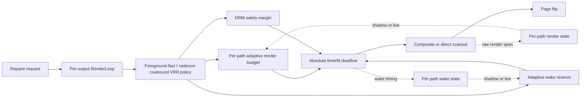

<div align="center">

# Linux Interactive Latency

**An experimental KWin build that wakes the compositor later and more precisely,
so a frame carries fresher input.**


</div>

> [!WARNING]
> This replaces a core desktop component. Do not install it without a rollback
> path you have tested. `install.sh` refuses to run unless a signed stock `kwin`
> package is already in your pacman cache, because a compositor that will not
> start is exactly when you cannot download one.
>
> Live kernel `dma_fence` tracing is prohibited here. It caused a kernel
> NULL-pointer fault on `7.1.4-1-cachyos`. See the
> [incident report](docs/INCIDENT_2026-07-23_DMA_FENCE_TRACE_KERNEL_OOPS.md).

## What this is

Stock KWin 6.7.5 adds a fixed 1 ms scheduler allowance to its predicted render
and DRM safety time, then arms a `QBasicTimer` after truncating the requested
delay to whole milliseconds. This project replaces that with an absolute timerfd
deadline and a reserve learned per output and per presentation path, so the
compositor stops overshooting and can be scheduled later.

It is a research package, not a general KWin performance preset.

## What is proven, and what is not

Being blunt about this matters more than the badges.

| Claim | Status |
| --- | --- |
| The stock delay is truncated to whole milliseconds and carries a fixed 1 ms allowance | Shown, from KWin 6.7.5 source |
| Precise wake delivery and per-output timing distributions | Measured, by instrumented capture |
| Controller behaviour on a captured wake distribution | Shown, by offline replay |
| **A measured input-to-photon improvement** | **Not shown.** No physical measurement exists yet |

The charts, the replay numbers, and the full claim table live in
[docs/SCHEDULING_MODEL_AND_CLAIMS.md](docs/SCHEDULING_MODEL_AND_CLAIMS.md). The
plan to close the measurement gap is in
[docs/INPUT_TO_PHOTON_MEASUREMENT_PLAN.md](docs/INPUT_TO_PHOTON_MEASUREMENT_PLAN.md).

## Quick start

The full tester path — install, verify, activate globally or per game, run a
fair comparison, report, recover — is in [TESTING.md](TESTING.md).

Read-only checks first. Neither changes system state.

```bash
./bin/kwin-latencyctl status
./bin/kwin-latencyctl test --source-only
```

Build and install. The guided script runs the preflight safety checks, the
build, and the install in one pass. A Wayland compositor cannot be replaced in
place, so a reboot or a full logout follows.

```bash
./install.sh
```

The gate is baked for the running kernel. To boot a different installed kernel
afterwards, such as one built from this collection's kernel patches, name it:
`./install.sh --kernel 7.2.9-1-cachyos-exp`.

Confirm after the restart.

```bash
./bin/kwin-latencyctl status
```

Since revision 22 the install changes nothing by itself: the policy is
**opt-in and off by default**. Turn it on per game (next section) or
session-wide. Both apply live, with no logout.

```bash
./bin/kwin-latencyctl enable    # session-wide, persists across reboots
./bin/kwin-latencyctl disable   # back to stock policy, also live
```

## Per-game toggling from Steam

The package installs `kwin-latency-game` into `/usr/bin`. In Steam, set a
game's launch options to:

```text
kwin-latency-game -- %command%
```

The wrapper enables the low-latency policy when the game starts and restores
the exact previous state when it exits, including on a crash or a kill. It
writes the `[LatencyExperiment]` group in `kwinrc` with change notification,
and the compositor picks the change up live through `KConfigWatcher` — no
restart, no logout.

Two limits. SIGKILL cannot be trapped, so a killed wrapper leaves the policy
enabled; `./bin/kwin-latencyctl status` shows it and `disable` clears it. And
Flatpak Steam cannot see `/usr/bin` or the host `kwinrc`, so the wrapper works
from native Steam only. On Flatpak, prefix it with `flatpak-spawn --host`.

The opposite direction also works. In a session that opted in with `enable`,
force stock policy for one game:

```text
kwin-latency-game --off -- %command%
```

From a repo checkout without the installed package, the same wrapper runs as
`./bin/kwin-latencyctl game -- COMMAND`.

The wrapper composes with
[low_latency_layer](https://github.com/Korthos-Software/low_latency_layer),
which paces the game process itself; see
[docs/LOW_LATENCY_LAYER_COMPARISON](docs/LOW_LATENCY_LAYER_COMPARISON_2026-08-10.md).

## If something goes wrong

Three exits, deliberately distinct.

```bash
./bin/kwin-latencyctl disable    # stock policy values, live on revision 22
./bin/kwin-latencyctl rollback   # restore signed repository KWin (reboot)
./bin/kwin-latencyctl remove     # reinstall repository KWin (reboot)
```

If the desktop will not start at all, switch to a text console with
`Ctrl+Alt+F3`, log in, and run:

```bash
sudo pacman -U "$(ls -t /var/cache/pacman/pkg/kwin-[0-9]*.pkg.tar.zst | head -n 1)"
```

Then reboot. The `kwin-[0-9]*` pattern matters: a bare `kwin-*` also matches
`kwin-x11` and every older cached version at once, and pacman then fails on
the conflict — at the worst possible moment. This is why the preflight insists
on a cached package.

If the pacman cache was cleaned since the install, `install.sh` kept a copy of
the stock package inside the repo:

```bash
sudo pacman -U "$(ls -t ./artifacts/rollback/kwin-[0-9]*.pkg.tar.zst | head -n 1)"
```

Run it from the repository root, or prefix the path with wherever you cloned the repo.

## What this project changes

Nineteen behaviours across twenty-one patches, in `patches/` order.

**Wake scheduling**

1. Backports KWin's merged absolute timerfd implementation.
2. Records desired, armed, and actual compositor wake timestamps per output.
3. Learns a bounded wake reserve independently for each output and presentation
   path: VSync, adaptive sync, async, and adaptive async.
4. Learns a bounded per-path render budget from measured render spans, and
   applies it by default since revision 20.
5. Replaces fixed-time live-controller tuning with nanosecond values derived
   from each output's current refresh duration.
6. Fail-closes every experimental behaviour behind an exact running-kernel
   release match.
16. Retires each wake sample once per armed wake, so no future dispatch path can
    train the margin controller twice from one physical wake.
17. Makes the adaptive wake margin, the adaptive render budget, and VRR cadence
    coalescing compiled-in defaults instead of an `environment.d` profile. The
    build machine's kernel release is baked in as the gate (`--kernel REL` on
    `install.sh` or `kwin-latencyctl build` names another installed kernel),
    so a kernel update fails closed to stock until the package is rebuilt.
    Every legacy environment variable still works as an opt-out override.
18. Makes the policy opt-in and runtime-switchable (revision 22). The adaptive
    margin, the render budget, VRR coalescing, and the scheduler margin read
    live from the `[LatencyExperiment]` group in `kwinrc` through
    `KConfigWatcher`, and the default is **off**: an installed package uses
    stock policy values until a tester opts in. This supersedes the always-on
    part of item 17; the exact-kernel gate stays a hard AND-condition, and
    every environment variable keeps working as the boot-time default.

**VRR and presentation**

8. Replaces the fixed 30 Hz unrelated-damage fallback on an active VRR output
   with an absolute deadline derived from measured foreground cadence.

**Colour pipeline and direct scanout**

10. Enables NVIDIA DRM plane colour pipelines only under the exact-kernel gate
    and NVIDIA driver 610.43.03 or newer.
11. Corrects KWin's inverse-sRGB low linear segment and adds boundary-focused
    round-trip coverage.
12. Reuses a fully keyed, single-entry direct-scanout colour transform in each
    output layer.
13. Removes recurring colour-path work: cached HDR metadata and identity
    transforms, const DRM-plane views, redundant-uniform suppression,
    precomputed shader reciprocals, and a tested opaque specialization.
14. Programs mandatory DRM named curves together with exact compensating
    inverses, including input-range normalization for NVIDIA's fixed PQ-125
    blocks and a deterministic numerical graph test.
19. Makes the mandatory NVIDIA CSC stage PQ domain convention
    runtime-selectable (`KWIN_DRM_NVIDIA_CSC_PQ_SCALE`, default UAPI 125),
    because the fixed hardware stages are unprogrammable and their
    convention is unverifiable from the DRM UAPI alone. See
    [DIRECT_SCANOUT_NVIDIA_INVESTIGATION](docs/DIRECT_SCANOUT_NVIDIA_INVESTIGATION_2026-08-23.md).

**Observation**

7. Contains an opt-in input telemetry probe, disabled in the reviewed policy.
9. Adds one exact-kernel-gated, default-off capture mode for compositor wake,
   render, direct-scanout decisions, DRM commits, input queues, GPU load, and
   audio.
15. Correlates completed compositor frames with DRM submission and page-flip
    callbacks, records non-overlapping phase boundaries, proves each output's
    buffered capture tail independently, and times cold colour construction in
    nanoseconds.

DRM/NVIDIA safety-margin learning, cross-output scheduling, input behaviour, and
kernel scheduling policy are deliberately unchanged.



## One reviewed policy, opt-in

No preset matrix and no tuning menu. Since revision 22 the reviewed policy is
compiled into the package but **inactive until a tester opts in**, per game or
per session. Opting in and out applies live through `kwinrc`.

| Component | State while opted in | State while off |
| --- | --- | --- |
| Absolute timerfd wakeup | On behind the baked kernel gate | On (merged upstream) |
| Per-output, per-path wake reserve | Adaptive | Stock fixed 1 ms allowance |
| Adaptive per-path render budget | Adaptive | Stock prediction |
| VRR unrelated-damage fallback | Cadence aligned; foreground damage stays immediate | Stock 30 Hz fallback |
| NVIDIA DRM plane colour pipelines | Separate explicit opt-in; needs the gate and driver 610.43.03+ | Off |
| Bounded compositor, DRM, and input capture | Disabled unless staged with `--capture` | Disabled |

The wake controller uses bounded integer work with no allocation, lock, sorting,
or file I/O. Its state is independent per output and per presentation path, and
resets after a refresh change.

## Safety model

Two conditions must both hold before any policy value changes:

1. The kernel release baked in at build time must exactly equal `uname -r`
   when KWin starts; `KWIN_COMPOSITOR_EXPERIMENT_KERNEL_RELEASE` overrides it.
2. The opt-in must be on: `Enabled=true` in the `[LatencyExperiment]` group of
   `kwinrc`, or the boot-time default `KWIN_LATENCY_EXPERIMENT=1`.

A kernel mismatch uses stock KWin 6.7.5 behaviour throughout: `QBasicTimer`,
the fixed scheduler allowance, stock render prediction, stock VRR fallback,
and no experiment telemetry. A missing opt-in keeps the stock policy values on
the merged-upstream precise timer.

That makes a differently versioned LTS or recovery kernel a fail-closed path. It
does not replace the need to preserve a known-good KWin package.

## Supported scope

Targets the official KWin 6.7.5 release tarball on an Arch-based Plasma system.
Do not install it over a different KWin release; port and rebuild the patches
instead, because internal render-loop APIs change.

Requires `makepkg`, a working Arch build environment, Python 3, `patch`, and
`bsdtar`. The PKGBUILD declares the KWin build dependencies.

The package uses the same pacman-visible version as its CachyOS base, so future
repository KWin updates remain eligible. See
[docs/PACKAGE_VERSIONING.md](docs/PACKAGE_VERSIONING.md).

## Capture and telemetry

To test the package and bounded telemetry after one restart, stage both
together:

```bash
./bin/kwin-latencyctl install --capture
```

Then reproduce a stable scene and collect a window:

```bash
./bin/kwin-latencyctl trace repeatable-game-scene
./bin/kwin-latencyctl capture-off
```

The trace directory holds raw KWin CSVs, GPU and PipeWire windows, scheduler and
IRQ deltas, plus `summary.md` and `summary.json`. See
[docs/BOUNDED_CAPTURE_MODE.md](docs/BOUNDED_CAPTURE_MODE.md).

`snapshot` collects read-only package, kernel, display, GPU, input, USB, IRQ,
scheduler, PipeWire, and DRM evidence under `artifacts/results/` without
enabling any hot-path telemetry.

`enable` and `esports` write both the live `kwinrc` opt-in and an
`environment.d` profile of boot-time defaults. `esports` additionally pins the
adaptive render budget to its active mode:

```bash
./bin/kwin-latencyctl enable
./bin/kwin-latencyctl esports
```

## Build and verify

```bash
./bin/kwin-latencyctl test
```

`test` changes no system state. It runs the controller and analyzer tests,
checks the generated graphs, verifies the official archive SHA-256, reapplies
patches `0001` through `0021`, byte-compares the 35-file patched overlay, and
validates the newest local package against its pinned checksum and its compiled
feature markers.

The pristine upstream tree is **not** committed. Verification extracts it from
the hash-checked release archive, so a fresh clone verifies without it. To keep
a local copy for browsing:

```bash
bsdtar -xf artifacts/sources/kwin-6.7.5.tar.xz -C reference/upstream/
```

## Source provenance

Two merged upstream commits are applied first:

- [`797d0820`](https://invent.kde.org/plasma/kwin/-/commit/797d0820e692de0907cbd00872abd8b3c016ce69): add `PreciseTimer`.
- [`cd46f9c9`](https://invent.kde.org/plasma/kwin/-/commit/cd46f9c9c34910a95b5ba8c83d8daffc248f4bb4): use it for compositor wakeups.

[`reference/patched-overlay/`](reference/patched-overlay/) holds every changed or
added source file, and [`reference/README.md`](reference/README.md) records the
archive hash, the file boundary, and the comparison commands.

## Repository layout

```text
.
├── bin/          Lifecycle command and the per-game Steam wrapper
├── patches/      Patch series in PKGBUILD order
├── models/       Executable timing reference models
├── tools/        Offline analyzers, replay, benchmarks, and bounded probes
├── scripts/      Provenance and graph verification
├── tests/        Deterministic policy and lifecycle tests
├── reference/    Patched overlay; pristine trees are re-vendored locally
├── docs/         Design, audit, graph data, and SVGs
├── bench/        Observer-cost microbenchmark
├── config/       Minimal generated-profile reference
├── artifacts/    Ignored packages, sources, and test snapshots
├── Makefile      Short aliases for lifecycle commands
└── PKGBUILD      Arch package recipe
```

## Documentation

**Start here**

| Document | Covers |
| --- | --- |
| [SCHEDULING_MODEL_AND_CLAIMS](docs/SCHEDULING_MODEL_AND_CLAIMS.md) | The model, the charts, and what the evidence does not support |
| [INPUT_TO_PHOTON_MEASUREMENT_PLAN](docs/INPUT_TO_PHOTON_MEASUREMENT_PLAN.md) | The missing whole-chain number and how to get it |
| [TESTER_OPT_IN_DESIGN](docs/TESTER_OPT_IN_DESIGN_2026-08-10.md) | Making this opt-in and hard to get stuck in |
| [BOUNDED_CAPTURE_MODE](docs/BOUNDED_CAPTURE_MODE.md) | The single capture toggle, schema, and cost boundaries |
| [PACKAGE_VERSIONING](docs/PACKAGE_VERSIONING.md) | Pacman-safe version ordering and upgrade policy |

**Design and audits**

| Document | Covers |
| --- | --- |
| [CAKE_COMPOSITOR_DESIGN](docs/CAKE_COMPOSITOR_DESIGN_2026-07-15.md) | Controller design and acceptance gates |
| [ADAPTIVE_RENDER_BUDGET](docs/ADAPTIVE_RENDER_BUDGET.md) | Timing formulas, state machine, fallback boundary |
| [ULTRA_LOW_LATENCY_STACK_V3_9](docs/ULTRA_LOW_LATENCY_STACK_V3_9.md) | Stack diagrams, cadence coalescing, multi-output behaviour |
| [WAYLAND_FRAME_PIPELINE](docs/WAYLAND_FRAME_PIPELINE.md) | End-to-end client, compositor, DRM, VRR, scanout trace |
| [COMPOSITOR_LATENCY_RESEARCH](docs/COMPOSITOR_LATENCY_RESEARCH_2026-08-08.md) | Cross-compositor survey, the Windows gap, ranked levers |
| [FRAME_PACING_CRITIQUE_AND_DESIGN](docs/FRAME_PACING_CRITIQUE_AND_DESIGN_2026-08-10.md) | Reflex-style pacing critiqued, and a deadline-hint design |
| [LOW_LATENCY_LAYER_COMPARISON](docs/LOW_LATENCY_LAYER_COMPARISON_2026-08-10.md) | How this compares to the Vulkan layer, and per-game toggling |
| [VRR_TIMING_AUDIT](docs/VRR_TIMING_AUDIT_2026-07-15.md) | Broader render, VRR, DRM, and input audit |

**Colour pipeline and NVIDIA**

| Document | Covers |
| --- | --- |
| [HDR_SDR_COLOR_PIPELINE_AUDIT](docs/HDR_SDR_COLOR_PIPELINE_AUDIT.md) | HDR/SDR math reconstruction and the inverse-sRGB defect |
| [NVIDIA_FENCE_AND_COMMIT_QUEUE](docs/NVIDIA_FENCE_AND_COMMIT_QUEUE.md) | Explicit-fence workaround and outstanding-commit queue |
| [NVIDIA_SDR_HDR_DIRECT_SCANOUT_UPSTREAM_REPORT](docs/NVIDIA_SDR_HDR_DIRECT_SCANOUT_UPSTREAM_REPORT_2026-07-22.md) | Reproduction, matcher failure, upstream relationship |
| [PURPLE_TINT_COLOR_PIPELINE_REVIEW](docs/PURPLE_TINT_COLOR_PIPELINE_REVIEW_2026-08-08.md) | Negative visual result and ranked colour-error hypotheses |

**Input, observation, incidents**

| Document | Covers |
| --- | --- |
| [INPUT_LATENCY_TELEMETRY](docs/INPUT_LATENCY_TELEMETRY.md) | Input probe design, capture protocol, redesign gate |
| [EVDEV_INPUT_LATENCY_PROBE](docs/EVDEV_INPUT_LATENCY_PROBE.md) | Gated evdev reader probe and interpretation boundaries |
| [OBSERVER_COST](docs/OBSERVER_COST_2026-07-17.md) | Hot-path audit and nanosecond benchmark |
| [INCIDENT_DMA_FENCE_TRACE_KERNEL_OOPS](docs/INCIDENT_2026-07-23_DMA_FENCE_TRACE_KERNEL_OOPS.md) | Kernel fault, separation from the KWin crash, trace-safety controls |

**Research, reviews, and historical protocols**

Dated records. They describe the state of the tree on that date and are not
updated afterwards.

| Document | Covers |
| --- | --- |
| [WHOLE_SYSTEM_LATENCY_RESEARCH](docs/WHOLE_SYSTEM_LATENCY_RESEARCH_2026-08-23.md) | Ranked latency levers across games, browsers, and the OS |
| [DIRECT_SCANOUT_NVIDIA_INVESTIGATION](docs/DIRECT_SCANOUT_NVIDIA_INVESTIGATION_2026-08-23.md) | Root cause of the purple tint and the patch 0021 live test |
| [END_TO_END_INTERACTIVE_PIPELINE](docs/END_TO_END_INTERACTIVE_PIPELINE.md) | Early whole-pipeline latency and efficiency policy |
| [PATCH_REVIEW_6.7.4](docs/PATCH_REVIEW_6.7.4_2026-08-06.md) | Patches 0001–0018 checked against KWin 6.7.4 |
| [PATCH_REVIEW_0021](docs/PATCH_REVIEW_0021_2026-08-27.md) | Review of the selectable CSC PQ scale patch |
| [PATCH_REVIEW_6.8](docs/PATCH_REVIEW_6.8_2026-10-07.md) | Upstream status of each patch against KWin 6.8 and the rebase plan |
| [CODE_REVIEW](docs/CODE_REVIEW_2026-08-07.md) | Findings from a full-tree review and their disposition |
| [HARDENING_FLAG_COST](docs/HARDENING_FLAG_COST_2026-08-07.md) | Runtime cost of the Arch hardening compiler flags |
| [REVISION_14_TEST_PROTOCOL](docs/REVISION_14_TEST_PROTOCOL.md) | HDR direct-scanout test protocol, superseded |
| [REVISION_15_TEST_PROTOCOL](docs/REVISION_15_TEST_PROTOCOL.md) | Corrected capture test protocol, superseded |
| [GOXLR_AUDIO_EFFICIENCY](docs/GOXLR_AUDIO_EFFICIENCY.md) | Unrelated audio-capture candidate; now in [audio/goxlr-utility](../../../audio/goxlr-utility/v1.2.4/) |

## Reporting a result

Use the collection's [test-result form](../../../.github/ISSUE_TEMPLATE/test-result.yml)
for a result, or its [bug-report form](../../../.github/ISSUE_TEMPLATE/bug-report.yml) for a build, install, or
rollback failure. A null result is data; report "no perceived difference" as
readily as an improvement, and run the same scene under `disable` as a control.

> [!CAUTION]
> `snapshot` and `trace` collect USB device lists, monitor EDID data, and
> package state. Those can carry device serial numbers and your hostname. Read
> the files and remove what you do not want public before you attach them.

A useful report includes:

- exact KWin package, kernel, GPU, and driver versions;
- monitor models, topology, modes, and refresh rates;
- VRR/tearing policy and whether direct scanout was active;
- game, scene, renderer, frame cap, and duration;
- whether the reviewed policy or stock behaviour was active;
- the snapshot directory and any external measurement output;
- relevant KWin, DRM, and GPU error logs;
- external latency methodology, if latency claims are made.

Do not submit learned-margin values without the presentation-tail and stability
data needed to interpret them.

## Contributing

[CONTRIBUTING.md](../../../CONTRIBUTING.md) covers the collection's patch-series
workflow and validation. The bundled installer retains its lock-screen, source
checksum and offline-recovery checks.

## Licensing

Original collection documentation and helpers use [GPL-2.0-only](../../../LICENSE).
The included KWin patches and 35-file `reference/patched-overlay/` retain their
upstream per-file SPDX terms; the [upstream license texts](LICENSES/) are included.
See the collection's [licensing notice](../../../LICENSING.md).
