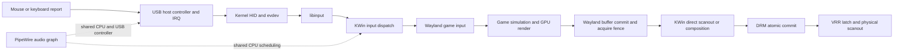
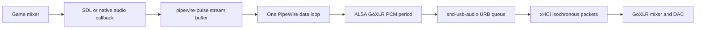
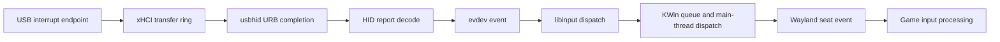
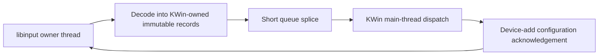

# End-to-end interactive latency and efficiency policy

Date: 2026-07-21

Status: live source and runtime audit. Only the KWin timer, adaptive wake
reserve, and VRR repaint changes are candidate behavior changes. Input, audio,
USB, NVIDIA fence, and scheduling findings remain measurement or design lanes
until they pass an end-to-end A/B test.

## Objective

The unit of optimization is one complete interactive transaction:



The acceptance metric is lower p99 and p99.9 input-to-presentation latency with
equal or lower CPU work and no new audio fault, page-flip failure, flicker, or
recovery regression. A local nanosecond saving is useful only when it removes
repeated work or shortens a critical dependency. It is rejected if the same
work or delay merely moves to another stage.

## Current live evidence

| Domain | Current evidence | Consequence |
|---|---|---|
| Outputs | DP-2 is 3840x2160 at 240.02 Hz, scale 1.5, HDR/WCG, automatic VRR; DP-3 is 1920x1080 at 59.99 Hz, HDR/WCG, automatic VRR | Per-output timing must remain independent; both outputs still share KWin's main thread and GPU |
| Idle output loops | KWin main, DP-2, and DP-3 accumulated zero runtime and zero switches during a static 10 second sample | There is no continuous display polling loop to remove |
| Input idle | The libinput thread accumulated zero runtime and zero switches during the same static sample | Do not add a polling or promotion policy for idle input |
| Audio graph | 48 kHz at 256 frames, a 5.33 ms cycle; the PipeWire data loop used 41.7 ms CPU and waited 0.094 ms on the runqueue during a loaded 10 second sample | The loop is about 0.42% of one CPU and is not presently CPU-bound |
| Audio work | Live `pw-top` work was usually single-digit microseconds per graph node and cycle | Smaller buffers would increase wake and graph overhead without proof of end-to-end benefit |
| Audio faults | No new GoXLR/PipeWire faults appeared during the current Unreal/build load; earlier overruns were a historical burst | Historical cumulative `ERR` counters are not evidence of a current fault storm |
| Scheduling | KWin main, both output threads, and libinput run at `SCHED_RR 1`; the game and PipeWire run at `SCHED_OTHER` | Restoring PipeWire through RTKit would make it `RR 20`, above the compositor and input, so it is excluded from the default policy |
| Mouse USB link | Logitech PRO X2 enumerates at USB full speed, 12 Mb/s, with a 1 ms interrupt interval | This live link cannot deliver 8,000 motion reports per second; software cannot turn it into a 125 microsecond high-speed endpoint |
| Keyboard USB link | Wooting 80HE enumerates at 480 Mb/s with a 125 microsecond endpoint interval | It is 8 kHz capable, but idle polls do not create 8,000 libinput events per second |
| Shared USB controller | GoXLR and Logitech mouse share one xHCI controller; the Wooting uses another | Moving the mouse to a high-speed port on a controller separate from GoXLR is a valid physical A/B test |

These values are a point-in-time local sample, not a universal benchmark.

## Audited source boundaries

| Layer | Source boundary | Exactness |
|---|---|---|
| KWin candidate | `reference/upstream/kwin-6.7.3` plus patches `0001` through `0010` | Exact candidate baseline and patch stack |
| KWin current master check | KDE commit `926a038b20e5528c5faf90d91d6c03c4cc7f4142` | Current comparison captured on 2026-07-21 |
| PipeWire | Upstream tag 1.6.8, commit `b741e0c74f5436f0c925f7741140db0efd32cf4e` | Exact installed upstream version |
| Running CachyOS kernel packaging | CachyOS `linux-cachyos` commit `b4fd74043cbd9c96d8c5bbea729b62ff34c17137` | Exact 7.1.3-2 package recipe; the `-2` change rebuilt NVIDIA 610.43.03 |
| Kernel implementation reference | Local Linux commit `4a50a141f05a8d1737661b19ee22ff8455b94409` | Nearby 7.2-rc source, not falsely presented as the exact running 7.1.3 source |
| Live kernel configuration | `/proc/config.gz` from 7.1.3-2-cachyos | Exact running config: high-resolution timers, full/dynamic preemption, no-HZ full, 1000 Hz, sched_ext, USB HID, and USB audio |

The exact CachyOS 7.1.3 source release is
`cachyos-7.1.3-1.tar.gz`; package revision 2 changed the bundled NVIDIA version,
not the kernel release tarball. Kernel implementation conclusions must still be
verified against that tarball before a kernel patch is produced.

## Audio pipe



PipeWire's 1.6.8 data-loop source blocks in `iterate(data, -1)`. It is
event-driven and does not spin while idle. The running graph uses a 256-frame
quantum at 48 kHz. The GoXLR capture hardware node uses a 128-frame period and
128-frame headroom. Linux's USB-audio endpoint code builds bounded URB queues,
uses completion callbacks, keeps capture URBs at or below 1 ms, and immediately
recycles low-latency or implicit-feedback playback URBs.

That means there is no redundant userspace polling loop to fold. The expensive
latency reservoir, when a game stream exists, is more likely its requested
client/Pulse buffer and the 256-frame graph quantum than the few microseconds of
PipeWire node work. A previously observed SDL stream requested a 768-frame
Pulse target length, 512-frame prebuffer, and 256-frame minimum request. Those
are client buffer targets, not proof that every sample waited the full target
length. They should be tested per game rather than replaced globally.

At the latest snapshot the SDL stream no longer existed. Only the GoXLR Utility
capture stream was active. Scheduling policy must distinguish that background
graph from actual game audio.

## Input pipe



The kernel's usbhid source takes the descriptor's `bInterval` unless a positive
mouse or keyboard polling override is set. Both overrides are zero on this
host. The completion callback resubmits the interrupt URB; libinput then wakes
from its file descriptor, and KWin wakes from a `QSocketNotifier`. None of these
stages require a userspace polling thread.

The largest presently actionable input issue is physical: the mouse negotiated
a 1 ms full-speed endpoint and shares its controller with the 125 microsecond
GoXLR audio traffic. Code cannot recover the missing endpoint opportunities.
Testing a different high-speed port/controller comes before a KWin mutex
rewrite.

## Scheduling rule

Realtime class is not an efficiency optimization. It changes which runnable
thread wins contention. A sleeping realtime thread consumes no CPU, but the
active GoXLR graph wakes hundreds of times per second. Promoting it to `RR 20`
would allow it to preempt KWin's `RR 1` work.

The default project policy therefore makes no PipeWire priority, affinity,
quantum, PulseAudio buffer, IRQ affinity, or CPU-governor change. Audio changes
require all of the following before admission:

1. a reproducible audio fault under the gaming workload;
2. a bounded candidate that fixes that fault;
3. unchanged or improved KWin/input scheduling tails;
4. unchanged or lower total CPU time; and
5. automatic rollback when XRUN or frame-tail counters regress.

## Input mutex decision

KWin 6.7.3 uses one `QRecursiveMutex` around libinput dispatch, the shared event
queue, device configuration, event decoding, motion coalescing, and downstream
signal emission. This is a wide critical section and is a legitimate design
smell. The existing local capture, however, measured approximately:

- producer wait p99 at or below 1 microsecond and maximum 60.3 microseconds;
- consumer wait p99 at or below 1 microsecond and maximum 0.221 microseconds;
- consumer hold p99 at or below 125 microseconds and maximum 229.4 microseconds.

The long motion ages occurred in startup or stalled batches, not as ordinary
mutex wait. A naive queue swap would let the libinput thread dispatch while the
main thread still reads libinput event objects or changes device configuration.
That changes thread-safety and device-add ordering, so it is not an acceptable
nanosecond optimization without a detached immutable event representation or a
libinput-thread ownership redesign.

The candidate redesign is two-stage, not merely “replace the mutex”:



It becomes worthwhile only if an 8 kHz-capable live capture shows material
producer blocking or event-age tails after excluding main-thread stalls.

## Work folding and coalescing decisions

| Candidate | Decision | Reason |
|---|---|---|
| Absolute timerfd compositor wake | Candidate default | Removes whole-millisecond timer truncation without a polling loop |
| Per-output and per-path wake reserve | Candidate default | Reuses every wake sample in bounded state; no allocation, mutex, sort, or file I/O |
| Cadence-aligned unrelated VRR damage | Candidate default | Coalesces cold damage to the next measured foreground opportunity while the foreground repaint path stays immediate |
| Cross-output global scheduler | Rejected for now | Adds a shared queue and new foreground deferral point; current loops already sleep independently |
| Input motion coalescing | Preserve | KWin already merges consecutive motion records in one drained batch |
| PipeWire graph merging | Already present | One data loop processes the active graph; extra manual aggregation would not remove the hardware quantum |
| Lower global PipeWire quantum | Rejected for default | Increases wakeups and CPU work; current graph is stable at 256/48000 |
| Static PipeWire realtime promotion | Rejected for default | RTKit priority 20 would outrank KWin/input priority 1 |
| NVIDIA 50 microsecond fence polling | Design candidate | Eventfd/fence-driven wake could remove polling and readiness quantization, but must preserve newest-commit replacement and driver restrictions |
| Lower DRM safety constants | Shadow-only candidate | A smaller number is unsafe until ioctl, scheduler, driver-apply, and flip-event delay are measured separately |
| Always-on telemetry | Rejected for gaming | On-demand snapshots and bounded research captures avoid permanent observer cost |

## Why small CPU savings are not automatically latency wins

At 240 Hz, removing 10 ns from one once-per-frame branch saves only 2.4
microseconds of CPU per second. At 8,000 events/s, removing 10 ns saves 80
microseconds per second. Those changes may still be worthwhile when free, but a
single missed 240 Hz presentation costs about 4.17 ms. The engineering order is
therefore:

1. remove missed deadlines and priority inversions;
2. remove shared critical-section tails;
3. remove unnecessary wakeups, copies, and syscalls;
4. then fold nanosecond-scale arithmetic and branches without obscuring the
   deadline model.

## On-demand evidence capture

`kwin-latencyctl snapshot LABEL` now captures the entire static boundary in one
artifact directory:

- exact packages, kernels, profile, and KWin state;
- monitor modes, VRR policy, DRM connectors, NVIDIA driver, and module state;
- every process/thread scheduling class and per-task scheduler counters;
- sched_ext and CPU frequency policy;
- PipeWire graph, quantum, thread policy, service age, and recent audio faults;
- USB topology, negotiated device speeds, autosuspend policy, and IRQ counters;
- kernel input devices and HID polling overrides.

It does not enable KWin telemetry, attach a profiler, change scheduling, or
leave a monitor running. Dynamic before/after captures still need an identical
game scene and an external optical or high-speed-camera input-to-photon test for
the final claim.

For a bounded workload measurement, run this while actively playing the same
repeatable scene in each candidate:

```bash
./bin/kwin-latencyctl trace stock-game
./bin/kwin-latencyctl trace candidate-game
```

`trace` takes one scheduler/IRQ snapshot at each boundary of a fixed 10-second
window and reports CPU runtime, runqueue wait, and context switches for KWin,
PipeWire, WirePlumber, and GoXLR threads. It records recent audio faults and a
final PipeWire graph snapshot. It does not sample continuously, promote a
thread, enable compositor telemetry, or expose another tuning parameter.
