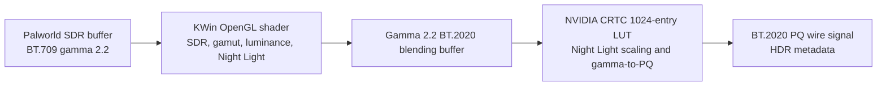

# KWin HDR, SDR, WCG, and direct-scanout audit

Date: 2026-07-21

## Engineering question

Can KWin correctly move the fullscreen Palworld frame from SDR into the active
HDR/WCG output path using NVIDIA fixed-function DRM color operations, thereby
removing the measured compositor render pass without changing color, HDR
metadata, Night Light, synchronization, or recovery behavior?

The performance target is the recurring compositor work, not only an average
frame-time percentage. Revision 11 measured 312,504 ns median render time at a
120 FPS cap and 1,128,000 ns median at about 197 FPS under high GPU load. Every
sampled fullscreen attempt was rejected by the color-pipeline gate.

## Exact live state

| Component | Observed state |
| --- | --- |
| KWin | 6.7.3-1.1, experiment revision 11 active |
| Kernel | 7.1.4-1-cachyos |
| NVIDIA | 610.43.03, `nvidia_drm.color_pipeline=Y` |
| Main output | DP-2, ASUS PG32UCDP, 3840x2160 at 240.016 Hz, scale 1.5 |
| Output color | HDR enabled, WCG enabled, EDID source, 300 nit SDR reference, 420 nit peak override |
| SDR gamut wideness | 100%, which makes KWin use the panel-native primaries for SDR content |
| Night Light | enabled and running at 4500 K |
| Color tradeoff | prefer efficiency and performance |
| Game color metadata | default SDR BT.709/gamma 2.2; Palworld configuration has HDR output disabled |

The PG32UCDP EDID reports 10 bits per primary, BT.2020 RGB support, ST2084 PQ,
507.620 nit desired peak, 265.047 nit desired frame-average luminance, and
native chromaticities of red (0.6767, 0.3212), green (0.2490, 0.6845), blue
(0.1464, 0.0566), and white (0.3134, 0.3291).

## Current path



KWin creates the direct-scanout transform before it imports the client buffer:

```text
ColorPipeline::create(candidate color, output layer blending color, intent)
```

Because that transform is non-identity and KWin 6.7.3 disables DRM plane color
pipelines by default on NVIDIA, `earlyScanoutCheckResult()` returns
`ColorPipelineUnsupported`. The rejection check is not the large cost. It
forces the OpenGL stage to execute, which is the measured 312,504-1,128,000 ns
median target.

## Reconstructed live transform

The audit utility links to the installed `libkwin` and uses KWin's own
`ColorPipeline::create()` and `ColorPipeline::evaluate()` implementations. It
reconstructs the EDID, output overrides, 100% SDR gamut setting, and 4500 K
Night Light state.

Night Light produces these values before the output pipeline is constructed:

```text
sRGB channel factors: 1.000000000 0.733519018 0.510838091
BT.2020-adapted:      0.891065240 0.749401927 0.538455069
adjusted white xyY:   0.359478253 0.362865066 0.774107337
adjusted reference:   232.232201099 nits
adjusted peak:        325.125081539 nits
```

The per-plane transform KWin asks hardware to represent has three operations:

1. Gamma 2.2 EOTF from encoded SDR into linear luminance.
2. A 3x4 matrix that combines BT.709/native-gamut mapping, reference-luminance
   scaling, black-point compensation, and the adjusted white point.
3. Inverse gamma 2.2 into the output's nonlinear BT.2020 blending encoding.

The matrix for the current state is:

```text
+2.211726427 +0.604460776 +0.093988739 0
+0.158771753 +2.717468739 +0.033936638 0
-0.007071416 +0.117982179 +2.799264908 0
```

The persistent CRTC stage then performs:

1. Gamma 2.2 EOTF over 0-325.125081539 nits.
2. Per-channel Night Light multiplier
   (1.151087523, 0.968085289, 0.695581973).
3. Inverse PQ EOTF for the BT.2020 wire signal.

The direct-scanout design does not bypass this CRTC stage. It replaces only the
OpenGL client-to-blending transform with the equivalent plane transform.

## NVIDIA hardware capability

A read-only DRM probe successfully enabled the per-file atomic and plane color
pipeline client capabilities. Each active NVIDIA primary plane exposes:

- NVIDIA Full;
- NVIDIA Lite;
- NVIDIA FP Full;
- NVIDIA FP Lite.

The Full pipeline contains multiple 3x4 matrices, two programmable 1024-entry
32-bit 1D LUTs, a multiplier, and named PQ curves. This is a strong structural
match for the current three-operation plane transform. It does not require a
low-resolution 3D LUT, so the AMD 17x17x17 shaper/3D-LUT banding failure is not
the mechanism used by this NVIDIA path.

Capability exposure proves that the driver offers the blocks. It does not prove
that KWin's matcher and NVIDIA's atomic validation will accept this exact
transform. That requires a restarted candidate followed by reason-coded capture
and visual validation.

## Upstream state and risk

KWin first disabled the feature on NVIDIA because color-op matching could crash
KWin. The stable fix now present in 6.7.3 checks every remaining color operation
for bypass capability before accepting an assignment. NVIDIA remains disabled
by default in the Plasma/6.7 branch as a conservative policy.

AMD has a separate history. An earlier Plasma 6.6 change disabled the pipeline
because of severe shaper/3D-LUT banding and driver bugs and expected restoration
in Plasma 6.7. Plasma 6.7 later disabled AMD again because bugs remained. Thus,
the statement that Plasma 6.7 generally restores the feature is no longer true
for the shipped 6.7.3 branch.

The experimental NVIDIA candidate therefore:

- activates only when `KWIN_COMPOSITOR_EXPERIMENT_KERNEL_RELEASE` exactly
  matches `uname -r`;
- requires NVIDIA driver 610.43.03 or newer;
- adds no new project configuration toggle;
- preserves upstream's explicit `KWIN_DRM_USE_COLOR_PIPELINE` override;
- requests the capability once at GPU initialization, adding no per-frame gate;
- leaves AMD disabled;
- fails closed on the LTS/recovery kernel.

## Color-math defect found during the audit

The CPU implementation of the inverse piecewise sRGB transfer function uses:

```cpp
normalized / 12.92
```

for the low segment. The inverse sRGB formula and KWin's GLSL implementation
use multiplication by 12.92. The current upstream master still contains the
division. A 0.02 encoded value round-trips through the CPU implementation as
0.000119813283, an error of -0.019880186717. Immediately below the segment
boundary, 0.04044 round-trips as 0.000242262458, then jumps to the correct
0.04045 at the boundary.

The existing color tests sample black, mid gray, white, and primaries, so they
do not exercise the low linear segment. Palworld's present default path uses
gamma 2.2 rather than the piecewise sRGB function and is not affected by this
specific defect. It must still be fixed before treating arbitrary sRGB DRM LUT
offload as robust.

Revision 12 binary validation compared the installed revision-11 library with
the packaged revision-12 library using the same audit executable. The installed
library round-tripped encoded `0.01` to `0.000059906641` and `0.04044` to
`0.000242262458`. The candidate returned every sampled value from `0` through
`0.05` with error below the printed 12-decimal precision. Disassembly of
`TransferFunction::nitsToEncoded(double)` in the candidate confirms that the
low segment is emitted as `vmulsd`, not a division.

## Nanosecond hot-path observation

KWin currently constructs the same three-operation direct-scanout
`ColorPipeline` on every attempt, before it knows whether scanout will succeed.
The exact reconstructed path measured:

```text
minimum: 236-237 ns
p50:     239-240 ns
p95:     340-359 ns
p99:     400-639 ns
```

Additional batched measurements of that exact three-operation pipeline show:

| Operation | Typical p50 |
| --- | ---: |
| Construct SDR-to-HDR pipeline | 240-241 ns |
| Copy the three-operation pipeline | 8 ns |
| Compare an equal cached pipeline | 11 ns |
| Reject a different pipeline at its first operation | 1.5-1.7 ns |

The packaged revision-12 library measured 249.562 ns p50, 296.281 ns p95, and
433.906 ns p99 for construction in the final validation run. These values are
host-load-sensitive microbenchmarks; they establish the scale of the work, not
a guaranteed frame-by-frame saving.

This is not remotely comparable to the 312,504-1,128,000 ns render pass, but it
is real recurring work. Revision 13 implements the cache in the owning output
layer, keyed by immutable source-description pointer, destination-description
pointer, rendering intent, and input type. The single last-value entry is
sufficient for a stable fullscreen game, requires no map, lock, allocation,
timer, telemetry, or configuration setting, and turns the normal path into
pointer and integer comparisons.

## Revision 13 avoidable-work implementation

The cumulative revision-13 patch removes recurring work without approximate
color math or a new runtime policy:

- stable direct-scanout attempts reuse the per-output `ColorPipeline`;
- returning from compositing restores that cached scanout pipeline without
  constructing it again;
- stable HDR metadata reuses the same immutable `ColorDescription` object;
- `DrmPlane::colorPipelines()` returns a const reference rather than taking an
  implicit-sharing reference-count trip at each caller;
- the OpenGL renderer keeps four fixed identity results, enough to isolate a
  small set of alternating source/destination paths without an allocation or
  hash lookup;
- a shader suppresses repeated color-matrix and uniform uploads when the exact
  immutable source, destination, and intent are unchanged;
- destination range and reference-luminance reciprocals and the tone-mapping
  coefficient are computed once on the CPU instead of repeated per pixel; and
- the opaque shader variant compiles out alpha unpremultiply/repremultiply only
  when the render node is known to have no alpha and opacity is exactly one.

The local patched-library microbenchmark measured:

| Revision-13 operation | Minimum | p50 | p95 | p99 |
| --- | ---: | ---: | ---: | ---: |
| Stable direct-scanout cache hit | 1.469 ns | 1.474 ns | 2.395 ns | 3.073 ns |
| Fallback then cached scanout restore | 12.245 ns | 12.829 ns | 21.290 ns | 23.382 ns |
| Stable HDR metadata cache hit | 3.073 ns | 3.082 ns | 4.280 ns | 6.059 ns |

Compared with the same host's 249.562 ns p50 and 433.906 ns p99 pipeline
construction baseline, the stable scanout attempt removes roughly 248 ns at
p50 and 431 ns at p99 from that CPU subpath. These are batched, host-load-
sensitive microbenchmarks, not input-to-photon claims. Shader savings still
need live GPU profiling because driver compilation and instruction scheduling
determine the final machine code.

The existing KWin color test was extended to render the generic and opaque
shader variants and require exact pixel equality. The patched test executable
passed all 48 cases; project-level keying, boundedness, and numerical checks
also pass.

## Revision 14 mandatory-curve compensation

The remaining direct-scanout rejection is not color conversion cost itself. It
is KWin's inability to assign the requested SDR-to-HDR transform across the
mandatory PQ named curves in NVIDIA's `Full` DRM plane graph. Revision 14
refines the direction proposed by upstream draft merge request !9297:

- a mandatory named curve before the requested transform is programmed and its
  mathematical inverse is threaded into a later programmable block;
- a mandatory named curve after the requested transform is programmed and its
  inverse is folded into the preceding programmable block;
- the fixed PQ-125 inverse input is normalized in an earlier matrix, preserving
  the measured `[-0.564198375, 232.232208252]` linear range instead of clipping
  values above 125 or losing the negative minimum;
- every mandatory block receives an assignment, so KWin never calls `bypass()`
  on a block that has no bypass property; and
- the existing successful/failed pipeline caches keep assignment search and
  compensation out of the steady frame hot path.

The deterministic test models the relevant NVIDIA sequence:

```text
programmable matrix
-> mandatory PQ-125 inverse EOTF
-> programmable LUT
-> mandatory PQ-125 EOTF
-> programmable matrix
```

It requires both mandatory operations to be programmed, rejects invalid
bypass, and evaluates the assigned hardware sequence against KWin's requested
gamma-2.2 inverse transform at the measured extrema, negative intermediate
values, black, SDR reference values, PQ-125, and values above 125. The current
test tolerance is `1e-5` per RGB vector and the full `kwin-testMockDrm` target
passes.

This is a source and numerical result, not yet a live latency win. The runtime
acceptance gate is a positive `direct_scanout_accepted` result followed by a
successful NVIDIA atomic commit with correct HDR/WCG color. If that succeeds,
the expected KWin-side win is removal of the measured recurring compositor
render stage, not merely the approximately 250 ns construction work removed by
revision 13. Monitor-internal HDR processing remains outside KWin and must be
measured separately.

## Code-design performance review

The current color pipeline has several strong design choices:

- adjacent matrices and multipliers are folded while the pipeline is built;
- matching DRM hardware blocks caches one successful and one failed pipeline;
- 1024-entry hardware LUTs and DRM property blobs are generated only after a
  cache miss, not on every frame;
- DRM feature sets, plane transforms, 16.16 source coordinates, and S31.32
  matrix encoding already use bit masks and shifts where the representation
  makes that exact;
- the direct-scanout transform remains per-output and does not couple DP-2 to
  the secondary output's color state.

Revisions 13 and 14 implement the measured bounded items above. The remaining
candidates require live evidence rather than speculative complexity:

1. The matcher cache holds only one success and one failure. Alternating SDR,
   HDR-video, and overlay transforms can evict each other and regenerate LUTs.
   If live traces show churn, replace it with a fixed two-to-four-entry array
   keyed by pipeline value; do not introduce a hash table or unbounded cache.
2. The generic fragment shader still selects source and destination transfer
   functions at runtime. Specializing every transfer-function pair would grow
   the shader matrix and compilation/cache footprint, so it is deferred until
   a GPU instruction/profile A/B shows that the dynamic path is material.

Replacing the floating-point divisions with bit shifts would be incorrect:
the denominators are luminance ranges and standardized transfer constants, not
integer powers of two. Compile-time ratios such as 2048/4096 are already folded.
Revision 13 explicitly passes the safe dynamic reciprocals as uniforms so the
source does not rely on driver strength reduction. Approximate `pow()`
replacements and global fast-math flags are
rejected without exhaustive color-error bounds because they can move the
piecewise thresholds, alter HDR metadata calculations, or produce visible dark
gradient errors.

The priority remains: first eliminate the complete compositing shader through
correct direct scanout; revision 13 removes the approximately 250 ns CPU
pipeline rebuild while scanout is attempted; then profile the generic shader
only for scenes that must remain composited.

## Acceptance sequence

1. Apply the inverse-sRGB correction and a boundary-focused unit test.
2. Build the exact-kernel-gated NVIDIA color-pipeline candidate.
3. Reboot the normal CachyOS kernel. If KWin fails, boot LTS; the pipeline gate
   will be false there, allowing package rollback.
4. Confirm the startup log identifies NVIDIA color-pipeline activation and all
   expected Full/Lite pipelines.
5. Capture the same Palworld scene at 120 FPS and uncapped.
6. Require `direct_scanout_accepted` rather than merely the disappearance of
   `color_pipeline_unsupported`.
7. Compare render duration, DRM commit tails, readiness waits, GPU power, missed
   presentations, NVIDIA Xid/reset logs, HDR metadata, and VRR behavior.
8. Validate gray ramps, dark gradients, saturated primaries, Night Light at
   4500 K, Night Light transitions, HDR video, SDR desktop, DPMS, lock/unlock,
   and the second monitor.
9. Keep the candidate only if color and stability remain correct and the
   repeated compositor pass is eliminated.

## Reproduction tools

```bash
g++ -std=c++20 -O2 -Wall -Wextra -Wpedantic \
  -I/usr/include/kwin tools/audit_kwin_color_pipeline.cpp \
  -o /tmp/audit_kwin_color_pipeline \
  $(pkg-config --cflags --libs Qt6Core Qt6Gui) -lkwin
/tmp/audit_kwin_color_pipeline

g++ -std=c++20 -O2 -Wall -Wextra -Wpedantic \
  $(pkg-config --cflags libdrm) tools/drm_color_pipeline_probe.cpp \
  -o /tmp/drm_color_pipeline_probe $(pkg-config --libs libdrm)
/tmp/drm_color_pipeline_probe /dev/dri/card1
```

Both tools are read-only. The first performs CPU calculations. The second sets
client capabilities only on its private DRM file descriptor and does not submit
an atomic commit or change display state.
