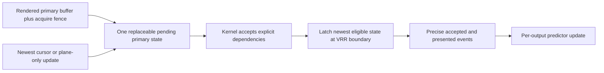

# NVIDIA explicit-fence and atomic-commit queue audit

Status: source audit, not a measured latency claim.

The current NVIDIA path contains two separate limitations. They are related to
DRM atomic presentation, but they are not the same bug and should not be fixed
with one speculative workaround.

## Audited versions

| Component | Evidence |
|---|---|
| KWin release reference | 6.7.3 in `reference/upstream/kwin-6.7.3` |
| KWin master snapshot | `926a038b20e5528c5faf90d91d6c03c4cc7f4142`, 2026-07-21 |
| NVIDIA source | 610.43.03, tag commit `452cec62d827034798072827d3866d1881662b77` |
| Live GPU driver family | NVIDIA open kernel modules 610.43.03 |
| Current-boot error scan | No KWin/NVIDIA atomic failure, EBUSY, fence, or pageflip-timeout message found in the user or kernel journal |

The relevant KWin fence condition is unchanged between the 6.7.3 reference
and the audited master snapshot. NVIDIA's outstanding-commit queue comment is
present in the exact 610.43.03 source.

## Limitation 1: NVIDIA rejects KWin commits with `IN_FENCE_FD`

KWin first started passing a plane's explicit input fence in commit
`120d14150128ffa6baf0bce1b275df3e4dd9153d`. NVIDIA systems then failed atomic
commits and could leave an external monitor black. KDE bug 478246 was closed by
commit `50899f3f34bacb70c5fcdc0e6dea1803400d0b60` on 2023-12-08.

That KDE resolution is a compatibility workaround, not proof of a driver-side
fix. KWin still excludes NVIDIA from `IN_FENCE_FD` in both 6.7.3 and the
2026-07-21 master snapshot:

```cpp
if (plane->inFenceFd.isValid()
    && !plane->gpu()->drmDevice()->isNvidia()
    && !isTearing()) {
    addProperty(plane->inFenceFd, buffer ? buffer->syncFd().get() : -1);
}
```

Without this property, KWin does not submit an unfinished buffer and let the
display commit wait on its fence. It retains the commit in the real-time DRM
thread, tests each buffer's sync fd with `poll(..., 0)`, and only submits when
all buffers are readable. For VRR or tearing, an unready commit advances its
target by 50 us and tries again.

### Possible cost

- Extra userspace wakeups and zero-timeout fence polls while a buffer is late.
- Readiness is acted on in 50 us target steps instead of being conveyed to the
  kernel as an explicit dependency.
- KWin cannot give NVIDIA an atomic update early while still allowing the
  display path to latch it immediately after rendering completes.

The bound is not "50 us added to every frame." If the fence is already ready
at the planned commit deadline, the workaround has essentially no readiness
penalty. When it is late, the first subsequent target can be up to one 50 us
step away, plus scheduler wakeup error and ioctl time.

## Limitation 2: NVIDIA disables its outstanding atomic-commit queue

NVIDIA's public source says its system already implements a queue of
outstanding commits, but it is not used because of internal bug 4054608. The
comment first appeared in the public 545.23.06 source commit on 2023-10-17 and
remains in 610.43.03. The public source does not describe the internal bug's
root cause, so this audit does not infer one.

For an affected CRTC, NVIDIA currently does this:

```text
nonblocking atomic commit
  -> flip_list empty: accept commit
  -> flip_list nonempty: return EBUSY
```

A blocking commit instead waits for the previous flip, with a three-second
failure timeout. KWin uses nonblocking commits and already mirrors this driver
constraint: its DRM thread keeps one `m_committed` transaction in flight and
waits for the pageflip event before submitting the next. Pending KWin commits
can be merged or replaced while they wait.

### Possible cost

- Cursor-only, overlay, and other plane updates cannot be accepted by the
  driver while a primary-plane flip is outstanding on the same CRTC.
- KWin cannot exploit a driver queue to submit independent work close to the
  latch boundary.
- The ioctl return timestamp is not the hardware-apply timestamp. KWin must
  retain a conservative DRM safety reservation and learn from an imperfect
  signal.

For ordinary VRR gaming with one primary update per presentation, this is not
evidence of an extra frame of latency: KWin already serializes to the flip
event and coalesces pending work. The limitation is more likely to show up as
cursor/plane-update delay and lost late-latch opportunity than as a constant
millisecond tax.

## Why blindly enabling a deeper queue is not the esports fix

A FIFO of two or three complete game frames would increase input age. The
useful design is bounded and newest-wins:



The target is one presented state, one replaceable pending state, and no FIFO
backlog. Independent cursor updates should be replaceable without waiting for
an old primary frame when hardware and UAPI permit it.

## Ranked engineering path

1. Measure fence-ready-to-ioctl, ioctl-to-pageflip, EBUSY, pageflip interval,
   and cursor-only wait time per CRTC with bounded KWin in-process telemetry.
   Kernel `dma_fence` tracepoints are prohibited after the
   `7.1.4-1-cachyos` trace-handler fault documented in
   `INCIDENT_2026-07-23_DMA_FENCE_TRACE_KERNEL_OOPS.md`.
2. Reproduce the `IN_FENCE_FD` failure on current NVIDIA 610.43.03 with a small
   atomic test before changing KWin's vendor gate. A source comment alone is
   not sufficient proof that today's hardware still rejects every form.
3. If current NVIDIA accepts the tested fence form, remove the KWin exclusion
   only behind capability and successful atomic-test detection, not a user
   toggle or driver-version guess.
4. Keep KWin newest-wins coalescing. If NVIDIA fixes 4054608, evaluate queuing
   independent cursor/plane state first; do not queue stale game frames.
5. Replace ioctl-return approximation with an attributable accepted/applied
   signal before shrinking the fixed DRM safety floor on NVIDIA.

## Acceptance gates

A candidate is an improvement only if it passes all of these:

- no atomic-test or presentation failures across VRR, fixed refresh, HDR/WCG,
  cursor movement, direct scanout, composition, and both outputs;
- no increase in missed-pageflip or pageflip-timeout rate;
- lower p50 and p99 fence-ready-to-submit or cursor-update-to-latch latency;
- no larger queue depth and no increase in input age;
- the 60 Hz output cannot force the 240 Hz output's pending primary state into
  FIFO waiting.

## Primary evidence

- KDE bug 478246: <https://bugs.kde.org/show_bug.cgi?id=478246>
- KWin workaround commit:
  <https://invent.kde.org/plasma/kwin/-/commit/50899f3f34bacb70c5fcdc0e6dea1803400d0b60>
- KWin adaptive safety commit:
  <https://invent.kde.org/plasma/kwin/-/commit/85eeafa09282cd6bda8effb0523ee656cb0eab2f>
- NVIDIA 545.23.06 source commit:
  <https://github.com/NVIDIA/open-gpu-kernel-modules/commit/b5bf85a8e3eb2516b9abca4d1becaf1172d62822>
- NVIDIA open kernel modules:
  <https://github.com/NVIDIA/open-gpu-kernel-modules>
