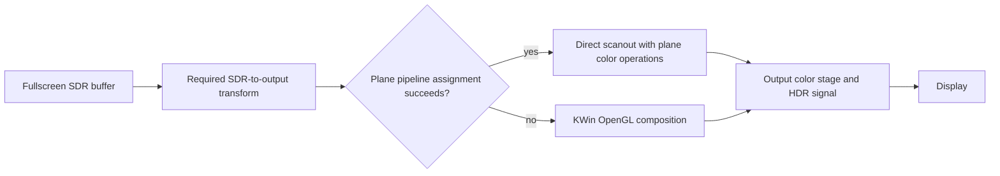

# KWin: NVIDIA DRM color-pipeline matching prevents SDR-to-HDR direct scanout

Status: draft for review; not submitted upstream

Date: 2026-07-22

Affected baseline: KWin 6.7.3

## Summary

A fullscreen SDR client cannot use direct scanout on the tested NVIDIA system
while the output is configured for HDR and wide color gamut, even though the
driver exposes DRM plane color pipelines with programmable matrices and 1D LUTs.

KWin correctly constructs a nonidentity transform from the client's SDR color
description to the output blending color space. Direct scanout then fails in
`EglGbmLayer::earlyScanoutChecks()` because none of the NVIDIA plane pipelines
are accepted by `DrmAbstractColorOp::matchPipeline()`.

The failure is caused by the color-operation assignment algorithm treating a
non-bypassable named transfer-function block as a hard barrier. NVIDIA's Full
pipeline contains mandatory PQ inverse-EOTF and PQ EOTF operations. KWin 6.7.3
cannot program those unavoidable operations and insert compensating inverse
operations into later programmable blocks, so the matcher returns
`std::nullopt`.

The client is consequently composited through KWin's OpenGL path. In the
captured workload, the retained KWin render stage measured 291,623 ns p50,
1,545,012 ns p95, and 1,645,219 ns p99 after transition samples were excluded.
These values are not end-to-end input latency, but they identify a recurring
software/GPU stage that direct scanout is intended to avoid.

An existing upstream draft,
[merge request !9297](https://invent.kde.org/plasma/kwin/-/merge_requests/9297),
implements compensation for non-bypassable named transfer functions and
explicitly identifies NVIDIA color pipelines as the target. As of 2026-07-22,
that merge request remains open, draft, and described as untested.

## Issue

### Expected behavior

When all other direct-scanout requirements are satisfied, KWin should assign the
required SDR-to-output color transform to a capable DRM plane pipeline and scan
out the fullscreen client buffer directly.

The hardware assignment must be mathematically equivalent to KWin's composited
color transform. Direct scanout must not change SDR reference luminance, gamut,
white point, Night Light behavior, HDR metadata, synchronization, or output
recovery.

### Actual behavior

KWin creates the required client-to-output color pipeline, but every exposed
NVIDIA pipeline returns false from `matchPipeline()`. The early scanout check
fails before buffer import or atomic commit. KWin falls back to composition.

In two ten-second captures:

| Outcome | Count |
| --- | ---: |
| Sampled DP-2 compositor frames | 165 |
| Fullscreen attempts rejected at the color-pipeline check | 150 |
| Frames where direct scanout was not attempted | 14 |
| Sample without a reason code | 1 |
| Accepted fullscreen attempts | 0 |
| Failed DRM commits | 0 |

The absence of failed DRM commits is expected: the rejection occurs during the
early matcher check, before KWin submits the candidate plane state.

## Affected configuration

The reproduced configuration is:

| Component | Observed value |
| --- | --- |
| KWin | 6.7.3 |
| Session | Plasma Wayland |
| GPU | NVIDIA GeForce RTX 4090 |
| Driver | NVIDIA open kernel modules and userspace 610.43.03 |
| Kernel | 7.1.4-1-cachyos |
| Primary output | DP-2, 3840x2160 at 240.016 Hz, scale 1.5 |
| Output color mode | HDR enabled, WCG enabled |
| SDR reference luminance | 300 nits |
| Peak override | 420 nits |
| SDR gamut wideness | 100% |
| Color preference | Prefer efficiency |
| VRR | Automatic and active during the game |
| Client | Fullscreen SDR BT.709/gamma-2.2 game surface |
| Client HDR setting | Disabled |
| Secondary output | DP-3, 1920x1080 at 59.989 Hz |

The client being SDR is important. Disabling HDR inside an application does not
switch an HDR desktop output to SDR. KWin must still transform that SDR surface
into the active HDR/WCG output blending space.

The problem is not limited to Palworld as an application. Palworld supplied the
reproducible fullscreen SDR workload. The relevant condition is any direct-
scanout-eligible SDR surface on an HDR/WCG output whose transform encounters the
same NVIDIA operation graph.

## Steps to reproduce

### Safety prerequisite

KWin 6.7.3 disables DRM plane color pipelines by default on NVIDIA because of
prior driver and matcher crashes. Reproduction should be performed on a
development system with a recovery session or alternate kernel available.

### Live reproduction

1. Run a debug build of KWin 6.7.3 on an NVIDIA system that exposes
   `DRM_CLIENT_CAP_PLANE_COLOR_PIPELINE`.
2. Place `KWIN_DRM_USE_COLOR_PIPELINE=1` in the KWin process environment before
   the compositor starts. This overrides the NVIDIA default-disable policy in
   `drm_gpu.cpp`.
3. Configure an output for HDR and WCG and select the efficiency color
   preference. The accuracy preference intentionally rejects nonidentity plane
   color pipelines in `earlyScanoutChecks()`.
4. Start a fullscreen Wayland or Wine-Wayland client that:
   - covers the output;
   - supplies a scanout-capable DMA-BUF;
   - is described as SDR BT.709/gamma 2.2;
   - has no compositor effect or overlay blocking direct scanout; and
   - does not request native HDR output.
5. Confirm that KWin initializes the NVIDIA Full, Lite, FP Full, and FP Lite
   plane color pipelines.
6. Break or log at:
   - `KWin::EglGbmLayer::earlyScanoutChecks()`;
   - `KWin::DrmAbstractColorOp::matchPipeline()`; and
   - `findColorPipelineAssignments()` in `drm_colorop.cpp`.
7. Observe that:
   - the requested layer color pipeline is nonidentity;
   - `m_plane->colorPipelines()` is nonempty;
   - every call to `matchPipeline()` returns false; and
   - `earlyScanoutChecks()` returns false at the no-match branch.
8. Confirm that the frame uses the composited render path and that no direct-
   scanout atomic commit is attempted.

Base KWin 6.7.3 does not emit a reason code for this branch. A debugger, a
minimal diagnostic log, or equivalent tracing is required to distinguish this
failure from other direct-scanout rejection reasons.

### Code-level reproduction

The failure can also be reproduced without a live display by constructing:

Requested logical pipeline:

```text
gamma22 EOTF
3x4 color/luminance matrix
gamma22 inverse EOTF
```

Representative NVIDIA Full hardware pipeline:

```text
Matrix [bypass]
PQ 125 EOTF [bypass]
1024-entry LUT [bypass]
Multiplier [bypass]
Matrix [bypass]
PQ 125 Inverse EOTF [mandatory]
Matrix [bypass]
1024-entry LUT [bypass]
Matrix [bypass]
PQ 125 EOTF [mandatory]
Matrix [bypass]
```

Call `findColorPipelineAssignments()` with that logical pipeline and hardware
chain. KWin 6.7.3 returns no assignment when it reaches a mandatory PQ operation
that cannot directly represent the current requested operation.

A deterministic unit test for this graph does not currently exist in KWin. Such
a test is the smallest reproducible upstream artifact this investigation
recommends adding.

## Investigation

### 1. The SDR-to-HDR transform is required

The fullscreen client buffer is SDR BT.709/gamma 2.2. The output remains in an
HDR/WCG mode. KWin therefore has to preserve the appearance of SDR content while
encoding the final output for the HDR display.

This is not a per-frame negotiation with the monitor. During steady state, the
output mode is already active. The additional stage under investigation is the
compositor's client-to-output transform and render pass.

KWin has two conceptually correct choices:



Switching the entire output to SDR for one client is not equivalent. It changes
the output policy for every surface and may trigger an HDR mode transition.

### 2. KWin creates the transform before checking scanout

In
[`src/compositor.cpp:381-382`](https://invent.kde.org/plasma/kwin/-/blob/v6.7.3/src/compositor.cpp#L381-382),
KWin creates the client-to-output pipeline and then calls the early checks:

```cpp
layer->setColor(candidate->colorDescription(),
                candidate->renderingIntent(),
                ColorPipeline::create(candidate->colorDescription(),
                                      backendOutput->layerBlendingColor(),
                                      candidate->renderingIntent()));
if (!layer->earlyScanoutChecks()) {
    return false;
}
```

For the reproduced SDR-to-HDR/WCG case, `ColorPipeline::create()` produces:

1. a gamma-2.2 EOTF to decode SDR into linear light;
2. a 3x4 matrix combining gamut, luminance, and white-point mapping; and
3. an inverse gamma-2.2 operation for the output blending encoding.

The pipeline is correctly nonidentity.

### 3. The early check requires one exact hardware assignment

In
[`src/backends/drm/drm_egl_layer.cpp:87-115`](https://invent.kde.org/plasma/kwin/-/blob/v6.7.3/src/backends/drm/drm_egl_layer.cpp#L87-115),
a nonidentity color pipeline is accepted only if at least one exposed plane
pipeline matches:

```cpp
const auto pipelines = m_plane->colorPipelines();
const bool match = std::ranges::any_of(pipelines, [this](DrmColorOp *colorop) {
    return colorop->colorOp()->matchPipeline(gpu(), m_colorPipeline);
});
if (!match) {
    return false;
}
```

The code is appropriately fail-closed. If KWin cannot prove and program an
equivalent transform, composition is safer than displaying incorrect color.

### 4. The NVIDIA pipelines are present

KWin enumerates nonzero `COLOR_PIPELINE` choices in
[`src/backends/drm/drm_plane.cpp:181-202`](https://invent.kde.org/plasma/kwin/-/blob/v6.7.3/src/backends/drm/drm_plane.cpp#L181-202).

A read-only DRM capability probe found 24 non-bypass choices across the active
primary planes. Each primary plane exposed four named shapes:

#### NVIDIA Full

```text
Matrix [bypass]
PQ 125 EOTF [bypass]
1024-entry LUT [bypass]
Multiplier [bypass]
Matrix [bypass]
PQ 125 Inverse EOTF [mandatory]
Matrix [bypass]
1024-entry LUT [bypass]
Matrix [bypass]
PQ 125 EOTF [mandatory]
Matrix [bypass]
```

#### NVIDIA Lite

```text
Matrix [bypass]
PQ 125 EOTF [bypass]
1024-entry LUT [bypass]
Multiplier [bypass]
Matrix [bypass]
```

#### NVIDIA FP Full

```text
Matrix [bypass]
Matrix [bypass]
PQ 125 Inverse EOTF [mandatory]
Matrix [bypass]
1024-entry LUT [bypass]
Matrix [bypass]
PQ 125 EOTF [mandatory]
Matrix [bypass]
```

#### NVIDIA FP Lite

```text
Matrix [bypass]
Matrix [bypass]
```

The Linux DRM color-operation API permits an operation to omit its `BYPASS`
property. An individual mandatory operation may therefore need to be programmed
even when userspace wants the overall pipeline to behave as though that
operation were absent.

### 5. The assignment algorithm cannot cross a mandatory unmatched curve

The root failure is in
[`src/backends/drm/drm_colorop.cpp:106-169`](https://invent.kde.org/plasma/kwin/-/blob/v6.7.3/src/backends/drm/drm_colorop.cpp#L106-169).

When no requested operations remain, KWin requires every remaining hardware
operation to support bypass:

```cpp
if (ops.empty()) {
    DrmAbstractColorOp *next = hardwareOp;
    while (next) {
        if (!next->canBypass()) {
            return std::nullopt;
        }
        next = next->next();
    }
    // assignment complete
}
```

When a hardware operation cannot represent the current requested operation,
KWin also fails immediately if that hardware block cannot be bypassed:

```cpp
if (!preference) {
    if (!hardwareOp->canBypass()) {
        return std::nullopt;
    }
    return findColorPipelineAssignments(hardwareOp->next(), ...);
}
```

The look-ahead search similarly stops at a non-bypassable operation. It cannot
search beyond that point for a programmable LUT that could compensate for the
unavoidable curve.

In
[`src/backends/drm/drm_colorop.cpp:907-953`](https://invent.kde.org/plasma/kwin/-/blob/v6.7.3/src/backends/drm/drm_colorop.cpp#L907-953),
`DrmNamed1DLut` advertises `Feature::Bypass` only when the DRM object exposes a
BYPASS property. It accepts a requested transfer function only when the named
enum matches. A mandatory `PQ_125_Inverse` block therefore cannot consume a
gamma-2.2 operation and cannot be skipped.

### 6. Failure is cached before atomic programming

`DrmAbstractColorOp::matchPipeline()` in
[`src/backends/drm/drm_colorop.cpp:256-289`](https://invent.kde.org/plasma/kwin/-/blob/v6.7.3/src/backends/drm/drm_colorop.cpp#L256-289)
calls the assignment search. If no assignment is returned, it caches that
pipeline as a failure and returns false. DRM properties are programmed only
after the search succeeds.

The normal commit path performs the same match in
[`src/backends/drm/drm_pipeline.cpp:275-288`](https://invent.kde.org/plasma/kwin/-/blob/v6.7.3/src/backends/drm/drm_pipeline.cpp#L275-288)
and returns `InvalidArguments` when no pipeline matches. The reproduced path does
not reach this point because the early scanout check has already rejected it.

## Root cause

KWin's matcher assumes that an unrequested hardware operation must expose
BYPASS. That assumption is too strict for operation chains containing mandatory
named transfer functions.

The NVIDIA Full pipelines expose useful programmable resources around mandatory
PQ operations. A valid assignment may need to program a mandatory function `H`
and then insert `H^-1` into a later programmable stage so the net transform
remains unchanged:


KWin 6.7.3 has machinery for propagating some input and output scaling between
operations, but it does not synthesize this compensating pair for a
non-bypassable named curve. The assignment search consequently returns failure
even when the operation graph may be representable.

This is an assignment-algorithm limitation. It is separate from:

- the Plasma 6.7 policy that disables the capability by default on NVIDIA;
- DMA-BUF format or modifier compatibility;
- game HDR support;
- VRR scheduling;
- monitor link negotiation; and
- an atomic commit failure.

## Hardware-chain results

| Hardware chain | Relevant capability | KWin 6.7.3 result | Reason |
| --- | --- | --- | --- |
| NVIDIA Full | Two programmable 1D LUTs, several matrices, mandatory inverse-PQ/PQ pair | Rejected | No compensation mechanism for mandatory named curves |
| NVIDIA Lite | One programmable 1D LUT plus matrices | Rejected | Cannot place both requested nonlinear operations around the cross-channel matrix |
| NVIDIA FP Full | One programmable 1D LUT plus matrices and mandatory inverse-PQ/PQ pair | Rejected | Encounters the same mandatory-curve limitation; representability still needs proof |
| NVIDIA FP Lite | Matrices only | Rejected | Matrices cannot represent the requested nonlinear gamma operations |

The Full chain is the primary candidate for compensated assignment, but hardware
capability exposure alone is not proof. A successful matcher result must still
pass numerical equivalence and NVIDIA atomic validation.

## Performance impact observed

The first 2,000,000,000 ns of each ten-second capture was excluded because the
capture was started before switching focus into the fullscreen game. This
removes the user-driven transition from the steady-state distribution.

The combined steady-state set contains 137 compositor frames and 1,863 DRM
samples:

| Stage | p50 (ns) | p95 (ns) | p99 (ns) | Maximum (ns) |
| --- | ---: | ---: | ---: | ---: |
| Wake lateness | 13,096 | 15,078 | 24,588 | 166,477 |
| KWin raw render | **291,623** | **1,545,012** | **1,645,219** | **1,659,633** |
| Presentation test | 22,684 | 27,492 | 30,366 | 31,482 |
| Present queue | 3,174 | 4,250 | 4,615 | 4,895 |
| DRM ioctl | 41,963 | 49,300 | 53,926 | 66,358 |
| DRM queue age | 187,276 | 198,566 | 206,171 | 1,285,916 |
| Callback after submit | 65,570 | 75,329 | 98,735 | 300,656 |

A 240.016-Hz refresh interval is approximately 4,166,389 ns. The measured KWin
render stage occupies about 7.0% of that interval at p50 and 39.5% at p99.

This duration is not automatically added one-for-one to input-to-photon
latency. It is the duration of a retained compositor stage. Successful direct
scanout may avoid that work, reduce GPU traffic and contention, and tighten tail
behavior, but the game render, synchronization, KMS, physical scanout, and
display processing remain.

## Testing methodology and evidence boundary

The code investigation was performed against a pristine extraction of the KWin
6.7.3 release archive. The archive SHA-256 is
`345b45d400884cc6b00f4b3585cc056aa2780f32afe2df394d20c5a98273c559`.
The official `v6.7.3` tag resolves to commit
`45ec9a6d0ed312a803ff5658a2a3e61f221566c6`.

Live testing used an instrumented KWin 6.7.3 executable for two purposes:

1. enable NVIDIA plane color pipelines on one explicitly selected kernel, rather
   than changing the behavior of recovery kernels; and
2. record a bounded reason code and nanosecond timestamps at the existing
   direct-scanout, render, and DRM boundaries.

The color-operation assignment algorithm in `drm_colorop.cpp` was not changed.
The diagnostic reason `color_pipeline_unsupported` corresponds specifically to
the existing no-match return in `EglGbmLayer::earlyScanoutChecks()`.

The executable also contained unrelated experimental hot-path changes.
Therefore:

- the 150/150 rejection result is directly attributable to the unchanged
  matcher branch;
- the timing distribution describes the tested executable and workload;
- the timing distribution sizes the compositing stage but is not presented as a
  stock-KWin regression measurement; and
- no performance improvement is claimed until a matching candidate is tested
  against the same workload.

The two bounded evidence windows are retained locally as:

- `20260722-114245-palworld-r13-120-trace`
- `20260722-114310-palworld-r13-120-trace`

A separate read-only DRM probe opened the NVIDIA DRM node, enabled client
capabilities only on that private file descriptor, enumerated color-operation
objects, and submitted no atomic commit. It reported 24 non-bypass plane
pipeline choices and the operation chains listed above.

## Upstream status

### Default policy in KWin 6.7.3

In
[`src/backends/drm/drm_gpu.cpp:116`](https://invent.kde.org/plasma/kwin/-/blob/v6.7.3/src/backends/drm/drm_gpu.cpp#L116),
KWin 6.7.3 disables plane color pipelines by default for both NVIDIA and AMD:

```cpp
s_colorPipelineEnv.value_or(!m_drmDevice->isNvidia()
                            && !m_drmDevice->isAmdgpu())
```

`KWIN_DRM_USE_COLOR_PIPELINE=1` overrides this policy for testing. The
capability gate and the matcher failure are separate layers: the override makes
the NVIDIA pipelines visible to KWin, but does not make the logical transform
match.

### Existing fix direction

[Draft merge request !9297](https://invent.kde.org/plasma/kwin/-/merge_requests/9297),
"backends/drm: handle non-bypassable named transfer functions," adds a
`bypassScaling()` method. When a mandatory named curve cannot represent the
current requested operation, the patch programs a supported curve and threads
its inverse forward for a later block to cancel.

Its public description states that the change is needed for NVIDIA color
pipelines and is untested. Its head is
`b69748905ec516777a4d026aa9a97452ab02d4ec`.

Source review found that the draft should not be applied verbatim:

- it declares a new non-pure virtual method without providing the base-class
  definition required by the vtable;
- the successful alternative branch does not add the mandatory named curve to
  that hardware operation's assignment, so programming can still attempt to
  bypass a block with no bypass property;
- it handles a mandatory curve before requested work but not the mandatory
  trailing curve present in NVIDIA's `Full` graph;
- its inverse/forward range calculation is reversed; and
- it models PQ-125 with a transfer-function maximum of 80 and normalized curves
  with 80, while the DRM UAPI defines PQ-125 output as 125 and KWin's existing
  named-curve scaling code uses 125 for PQ and 1 for normalized curves.

As of upstream commit
[`05df3e5199ec6f18386456df51d1675eed66da09`](https://invent.kde.org/plasma/kwin/-/commit/05df3e5199ec6f18386456df51d1675eed66da09),
the matcher still contains the immediate failure for an unmatched,
non-bypassable hardware operation, and !9297 remains unmerged.

### Related safety work

- [Merge request !9278](https://invent.kde.org/plasma/kwin/-/merge_requests/9278)
  prevents the matcher from treating a non-bypassable color operation as though
  it could be bypassed.
- [KDE bug 520842](https://bugs.kde.org/show_bug.cgi?id=520842) documents an
  NVIDIA 610 matcher crash. The resulting safety correction does not add the
  compensation required for successful matching.
- [Merge request !9426](https://invent.kde.org/plasma/kwin/-/merge_requests/9426)
  retains the NVIDIA default-disable policy on the Plasma 6.7 branch following
  crash reports.
- [Merge request !9300](https://invent.kde.org/plasma/kwin/-/merge_requests/9300)
  concerns post-blending color pipelines and is not the immediate pre-blending
  plane-assignment failure reproduced here.

## Recommended resolution

Use !9297 as the design starting point, but refine it against a deterministic
NVIDIA graph test before proposing it upstream. The required implementation
must assign the mandatory curve itself, compensate both leading and trailing
mandatory curves, normalize fixed PQ-125 inputs without clipping the requested
range, and leave insufficient graphs rejected.

A local validation candidate now implements that refinement against KWin 6.7.3.
It is suitable for source, numerical, package, and live wall-clock testing; it
is not yet evidence of a resolved upstream issue.

### Required matcher tests

Construct mock DRM color-operation chains matching NVIDIA Full, Lite, FP Full,
and FP Lite. Use the exact requested logical pipeline:

```text
gamma22 EOTF
3x4 matrix
gamma22 inverse EOTF
```

The tests should require:

1. the unmodified KWin 6.7.3 matcher reproduces the rejection;
2. a compensated Full assignment succeeds only when every mandatory operation
   is programmed;
3. no operation without BYPASS is silently omitted;
4. every injected inverse or scaling operation is consumed;
5. insufficient chains continue to reject instead of approximating the
   transform;
6. matcher success and failure caches preserve the result; and
7. operation ordering remains exact.

### Required numerical tests

Evaluate the requested KWin transform and the assigned hardware sequence over:

- black and transfer-function thresholds;
- values immediately below and above each threshold;
- a dense dark ramp;
- neutral grays;
- RGB and CMY primaries;
- SDR reference white;
- configured panel peak;
- out-of-gamut and negative intermediate values; and
- a three-dimensional color grid.

Error must be reported in linear luminance and encoded output. Tolerances should
come from the actual LUT and fixed-point formats, not from an 8-bit screenshot.

The PQ-125 scale in !9297 requires an explicit unit test. The DRM UAPI states
that the PQ EOTF is scaled so 10,000 nits corresponds to `125.0f`. KWin's
existing named-curve input/output scaling consequently uses 125 as the maximum
linear value. The draft's `10'000 / 125` maximum is 80 and does not describe
that hardware domain.

### Required live tests

After unit and numerical tests pass, test the exact NVIDIA atomic path:

| Scenario | Acceptance condition |
| --- | --- |
| Fullscreen SDR client on HDR/WCG output | Direct scanout accepted and equivalent color |
| 120-FPS and uncapped VRR | No regression in wake, commit, queue, or callback tails |
| Night Light neutral and active | Correct white point, no banding or stale state |
| Native HDR content | Correct metadata and tone mapping |
| SDR output mode | Identity and SDR transforms remain correct |
| Cursor and overlays | Clean fallback and re-entry |
| Multiple outputs | No cross-output color or cadence contamination |
| Alt-Tab, lock/unlock, DPMS | No crash, Xid, black screen, flicker, or stale pipeline |

Success must mean a positive direct-scanout acceptance and a valid atomic commit.
The disappearance of one rejection reason is not sufficient.

## Related finding not responsible for this failure

KWin 6.7.3 and the inspected upstream master implement the low segment of
`TransferFunction::nitsToEncoded()` for sRGB as `normalized / 12.92`. The
inverse sRGB formula requires `normalized * 12.92`.

The reproduced Palworld transform uses gamma 2.2, so this defect is not the cause
of the current matcher rejection. It is relevant to broad validation of !9297
because the draft may use `nitsToEncoded()` while constructing compensation for
an sRGB named curve. It should be handled and tested as a separate correctness
change.

## Source trail

### KWin

- [KWin v6.7.3 direct-scanout preparation](https://invent.kde.org/plasma/kwin/-/blob/v6.7.3/src/compositor.cpp#L357-395)
- [KWin v6.7.3 early DRM scanout checks](https://invent.kde.org/plasma/kwin/-/blob/v6.7.3/src/backends/drm/drm_egl_layer.cpp#L87-120)
- [KWin v6.7.3 plane color-pipeline enumeration](https://invent.kde.org/plasma/kwin/-/blob/v6.7.3/src/backends/drm/drm_plane.cpp#L181-202)
- [KWin v6.7.3 color-operation assignment search](https://invent.kde.org/plasma/kwin/-/blob/v6.7.3/src/backends/drm/drm_colorop.cpp#L106-175)
- [KWin v6.7.3 matcher and programming path](https://invent.kde.org/plasma/kwin/-/blob/v6.7.3/src/backends/drm/drm_colorop.cpp#L256-289)
- [KWin v6.7.3 named transfer-function matching](https://invent.kde.org/plasma/kwin/-/blob/v6.7.3/src/backends/drm/drm_colorop.cpp#L907-953)
- [KWin draft merge request !9297](https://invent.kde.org/plasma/kwin/-/merge_requests/9297)
- [KWin !9297 head commit](https://invent.kde.org/plasma/kwin/-/commit/b69748905ec516777a4d026aa9a97452ab02d4ec)

### Linux DRM

- [DRM color-operation interface](https://git.kernel.org/pub/scm/linux/kernel/git/torvalds/linux.git/tree/include/drm/drm_colorop.h)
- [DRM color-pipeline documentation](https://git.kernel.org/pub/scm/linux/kernel/git/torvalds/linux.git/tree/Documentation/gpu/rfc/color_pipeline.rst)

## Conclusion

The issue is a specific mismatch between KWin's assignment model and NVIDIA's
DRM color-operation graph. The hardware exposes mandatory named PQ curves, while
KWin 6.7.3 assumes an unrequested operation must be individually bypassable.
That assumption prevents the matcher from reaching a potentially valid
compensated assignment and forces fullscreen SDR content through composition on
an HDR/WCG output.

The existing !9297 draft proposes the right class of solution but is incomplete
for the observed graph. A refined local candidate now supplies a deterministic
matcher test, fixed PQ-125 domain handling, mandatory-operation assignment, and
leading/trailing compensation. The remaining proof is live NVIDIA atomic
validation: positive direct-scanout acceptance, correct HDR/WCG color, stable
fallback and re-entry, and nanosecond distributions showing removal of the
recurring compositor render stage.
