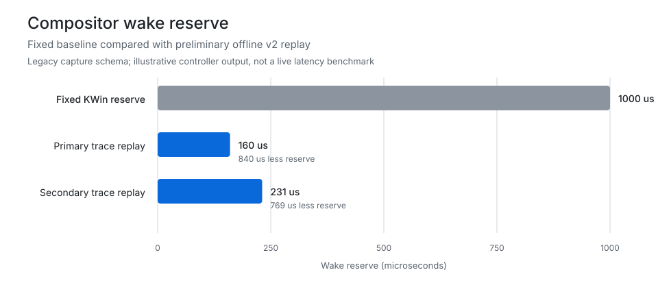
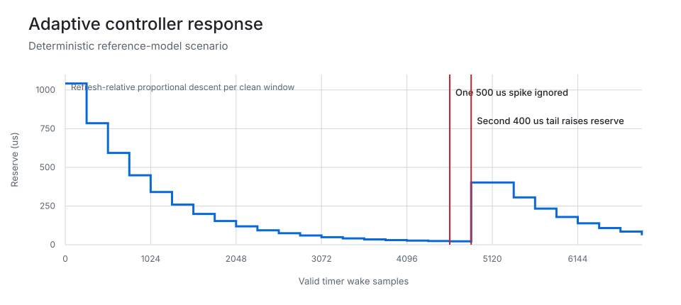
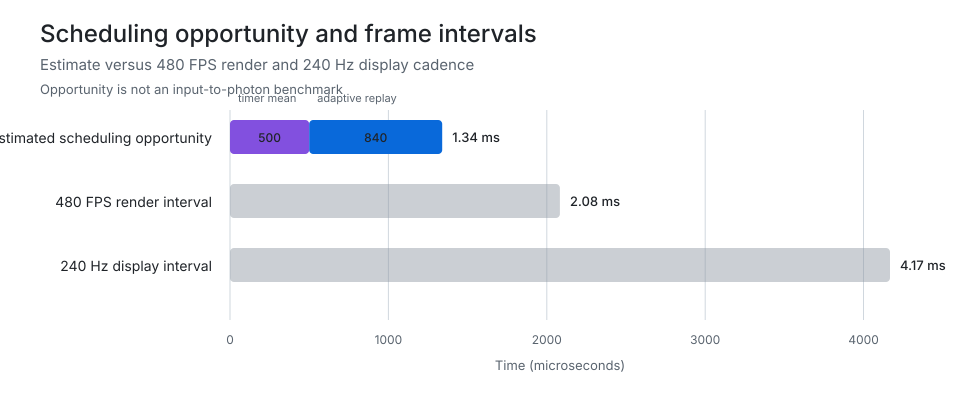

# Scheduling model, evidence, and claim boundaries

Moved out of README.md so the landing page stays short. This is the honest
accounting of what this project has shown and what it has not.

## Performance standard

This project evaluates latency at nanosecond granularity. Recurring microsecond
and millisecond costs are primary optimization targets, not rounding error:
0.3-1.1 ms is 300,000-1,100,000 ns. Measurements should retain nanosecond
resolution where supported and include event frequency, steady-state cost,
jitter, and tail latency rather than relying on averages alone.

The investigation actively seeks removable waits, timer quantization, polling,
queueing, synchronization, redundant rendering, locks, allocations, system
calls, and cache-line contention throughout the render, DRM, input, audio, USB,
and scheduling paths. A win is only claimed with attributable live evidence;
color correctness, synchronization, stability, and rollback safety remain hard
requirements. When those requirements block an optimization such as direct
scanout, the exact blocker becomes a design target instead of a reason to
dismiss the potential latency reduction.

## Preliminary scheduling model

The following charts explain the current hypothesis. They do not claim a
measured input-to-photon improvement.

The replay used a legacy shadow capture and therefore cannot deduplicate every
frame-completion row. It predicts a substantially smaller steady VSync reserve,
but a new-format live v2 capture is required before this can be considered a
performance result.

The wake controller consumes safety credit proportionally, ignores one isolated
spike, and pays repeated tail debt immediately. Two stalls above its
refresh-relative ceiling in the same window restore that ceiling.

The 1.34 ms figure combines a theoretical 0.5 ms mean from eliminating
whole-millisecond timer quantization with an 0.84 ms primary-trace replay
reduction. It describes an opportunity to schedule KWin later, not a guaranteed
gaming-latency reduction.

This final chart covers only the fallback for unrelated damage while a fast
active surface controls VRR. Continuous foreground damage cancels either
fallback and schedules normally. Revision 3.9 tightens the stalled/transition
ceiling without delaying the game path.

### Claim boundaries

| Evidence | Supports | Does not support |
| --- | --- | --- |
| KWin 6.7.4 source | The old delay is truncated to whole milliseconds and includes a fixed 1 ms allowance | A measured 1 ms end-to-end latency regression |
| Instrumented timerfd capture | Precise wake delivery and raw per-output timing distributions | Input-to-photon latency without an external measurement device |
| Legacy offline v2 replay | Controller behavior on the captured wake distribution | A live v2 result or a universal margin target |
| Reference-model tests | Refresh scaling, reset behavior, path isolation, and outlier handling | Real GPU, KMS, VRR, or game stability |
| Revision 3.9 source and model | The foreground branch is immediate and the fallback is phase/cadence derived | A measured gaming-latency reduction before A/B testing |

At 240 Hz, one display interval is 4.17 ms. At 480 FPS, one game-render interval
is 2.08 ms. A later compositor wake can reduce buffer age or occasionally allow
a newer client buffer to reach the same presentation target. Direct scanout,
game-side queues, and hardware cursor paths can make the end-to-end benefit much
smaller than the compositor scheduling shift.
