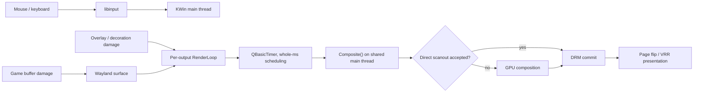
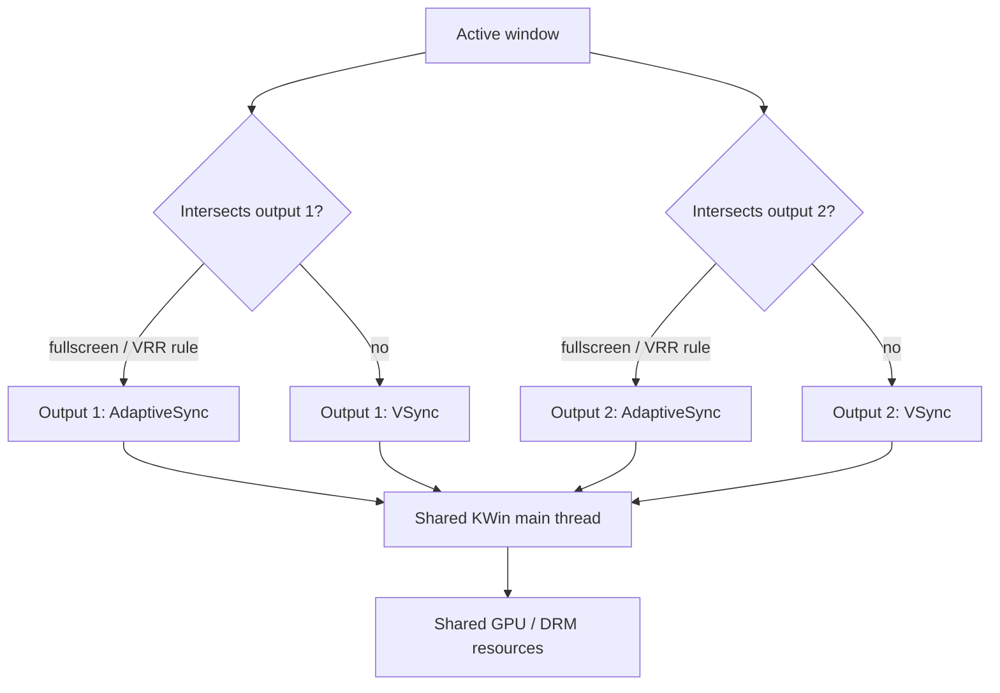
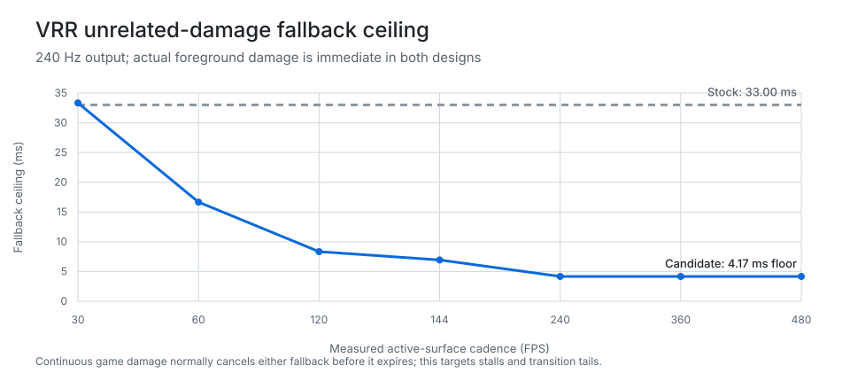
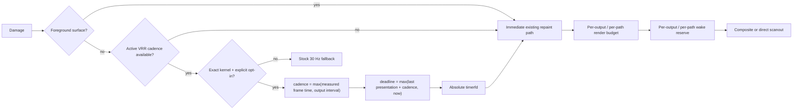
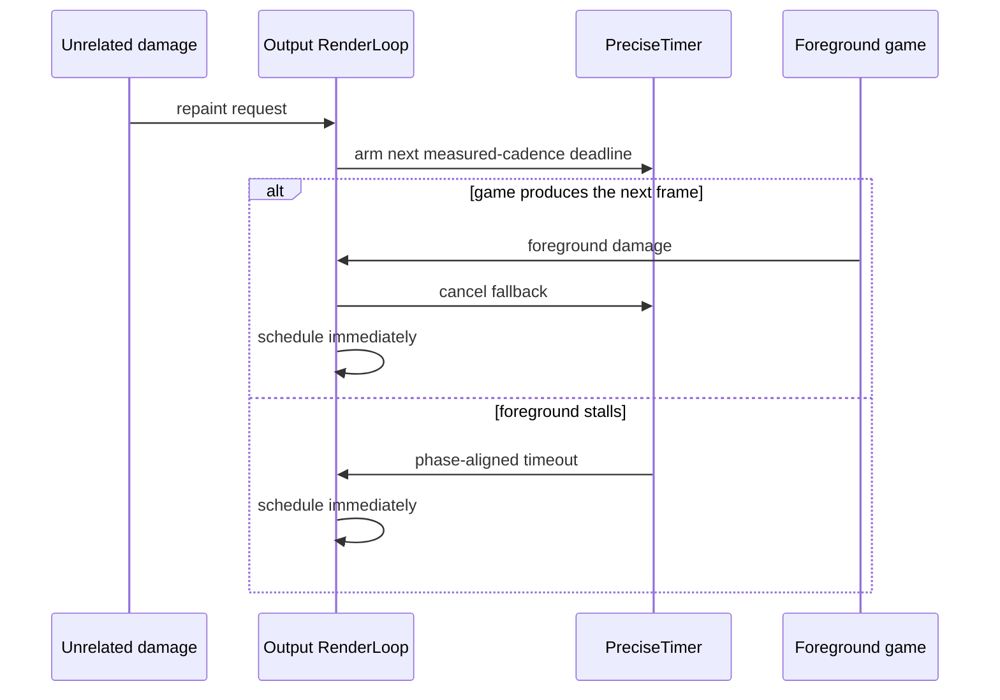

# Ultra-low-latency KWin stack, revision 3.9

## Outcome

Revision 3.9 keeps the active game repaint path immediate and replaces KWin's
fixed 30 Hz fallback for unrelated damage on an active VRR output with a
deadline derived from that output's measured foreground cadence. The deadline
is phase-aligned to the last presentation and cannot be later than the next
expected foreground frame. If that deadline has already passed, the repaint is
requested immediately.

This is intentionally narrower than a new compositor scheduler. It improves a
real stall and transition tail without putting foreground rendering behind a
new queue.

## Original stack

Each output owns a RenderLoop and chooses VRR independently, but both outputs
ultimately call `Compositor::composite()` on KWin's shared main thread.

KWin does not currently have a global "game output" scheduler. Desktop output
priority controls layout, not render-loop service order. Adding a new global
arbiter would require queuing ready frames and could add latency, so revision
3.9 does not do that.

## Fixed fallback problem

In KWin 6.7.3, unrelated damage on an output whose active surface is driving
VRR arms a `1000 ms / 30` `QBasicTimer`. Foreground surface damage cancels that
timer and schedules normally, so a continuously rendering game is not normally
held for 33.3 ms. The fixed fallback matters when the foreground cadence stalls,
drops, or changes while other content needs repainting. Repeated unrelated
damage can also keep restarting the fixed timer.

The chart is a policy ceiling, not an input-to-photon result. At 240 Hz, the
candidate's maximum wait is one phase-aligned 4.17 ms output interval for a
240+ FPS foreground cadence. If part of that interval has already elapsed, the
actual fallback is shorter. Foreground game damage remains immediate.

## Revision 3.9 stack

## scx_cake principles applied

| scx_cake lesson | KWin application |
| --- | --- |
| Fast path by construction | Foreground damage never enters a new queue or controller |
| Route from current state | Uses active-output intersection, measured surface cadence, output refresh, and last presentation |
| Per-domain state | Existing wake and render controllers remain per output and presentation path |
| Bounded work | Constant comparisons and integer chrono arithmetic; no loop, sort, or search added |
| Avoid shared hot state | No process-global game flag, mutex, atomic counter, or cross-output queue |
| Hysteresis and asymmetric debt | Existing controllers pay repeated tail debt immediately and consume clean safety credit gradually |
| Fail closed | Exact kernel mismatch or missing opt-in preserves the stock fallback |
| Measure tails, not only means | Acceptance requires p95/p99/p99.9 presentation and stability evidence |

## Hot-path cost boundary

The foreground test already called `recursiveFrameTimeEstimation()` in stock
KWin. Revision 3.9 returns that existing result instead of converting it to a
boolean and recomputing it. The foreground path adds no allocation, mutex,
clock read, telemetry, or timer arm. Stopping an inactive timer is a boolean
test and no timerfd syscall.

Only unrelated VRR damage in enabled mode takes the colder path: one monotonic
clock read, fixed chrono arithmetic, and one absolute `timerfd_settime()`.
`PreciseTimer` objects are allocated once per output at RenderLoop construction,
not per repaint.

## Safety and scope

- `KWIN_VRR_REPAINT_COALESCING=1` is required.
- `KWIN_COMPOSITOR_EXPERIMENT_KERNEL_RELEASE` must exactly match `uname -r`.
- A missing or mismatched gate uses stock KWin behavior.
- State is naturally per output because every output owns its RenderLoop.
- The change does not alter direct-scanout acceptance, NVIDIA fence handling,
  DRM commit safety margins, input dispatch, or kernel scheduling.
- Diagnostic telemetry can remain off; this policy does not depend on it.

The candidate cannot yet claim lower input-to-photon latency. It has source,
model, compile, and package proof. Real acceptance still needs controlled A/B
testing and, for an end-to-end claim, an external optical measurement.

## Test gates

1. Compare stock fallback and revision 3.9 with the same game, scene, cap,
   monitor layout, VRR policy, kernel, driver, and power state.
2. Exercise continuous rendering, loading stalls, alt-tab, overlays,
   notifications, cursor movement, and focus changes across both outputs.
3. Reject on any increase in flicker, page-flip timeout, NVIDIA Xid, target
   misses, or p99.9 frame delivery.
4. Confirm direct scanout, HDR/color, tearing, capture, and recovery-kernel
   behavior separately.

## Deliberately deferred ideas

| Candidate | Why it is not in revision 3.9 |
| --- | --- |
| Cross-output EDF/game-first arbitration | Requires a new shared queue or deferral point on KWin's main thread; could add foreground latency |
| Lower DRM commit safety margin | NVIDIA's userspace fence wait and commit timing need attributable shadow measurements before reducing safety reserve |
| Input queue redesign | Existing measurements did not justify changing the mutex/dispatch semantics; a wrong handoff optimization can worsen tails |
| Always-on telemetry | Useful for experiments but not free; lowest-overhead gaming profile keeps it disabled |

These remain candidates only after a measurement identifies the exact losing
path. Revision 3.9 does not trade correctness or stability for a smaller
constant on paper.
