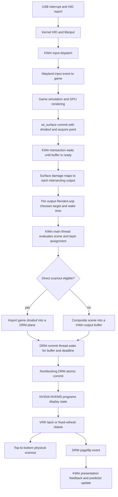
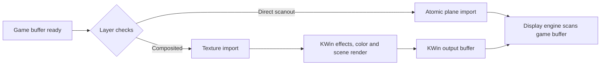
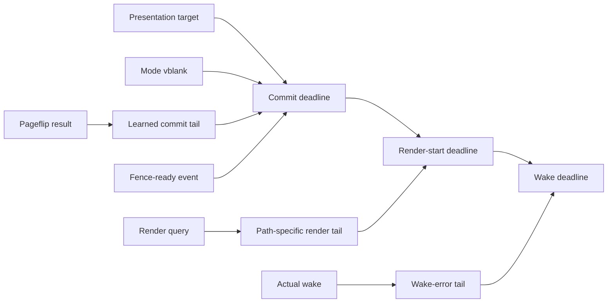

# Wayland frame pipeline and adaptive latency audit

Status: source audit and design proposal, not a claim of measured end-to-end
latency improvement.

This document follows one frame from an input event to physical scanout on the
current machine. It distinguishes values that directly defer work from safety
reservations, estimator memory, protocol units, and failure timeouts. A value
written in milliseconds is not automatically a millisecond of added latency.

## Audited baseline

| Layer | Audited version or live state |
|---|---|
| KWin package source | 6.7.3 in `reference/upstream/kwin-6.7.3` |
| Current KWin master check | `926a038b20e5528c5faf90d91d6c03c4cc7f4142`, 2026-07-21 |
| Timing-file result | The eight audited scheduling/DRM files are byte-identical between 6.7.3 and that master snapshot |
| Running kernel | `7.1.3-2-cachyos` |
| Installed next kernel | `7.1.4-1-cachyos` |
| Kernel config | high-resolution timers, tickless idle, dynamic preemption, 1000 Hz tick, sched_ext |
| GPU | NVIDIA RTX 4090, open kernel modules 610.43.03 |
| Main output | DP-2, ASUS PG32UCDP, 3840x2160 at 240.016468 Hz, VRR 80-240 Hz, scale 1.5, HDR/WCG |
| Side output | DP-3, Dell AW2521H, 1920x1080 at 59.989221 Hz, scale 1.0, HDR/WCG |

The current KWin master comparison covered:

- `src/core/renderloop.cpp`
- `src/backends/drm/drm_commit_thread.cpp` and `.h`
- `src/backends/drm/drm_commit.cpp`
- `src/compositor.cpp`
- `src/scene/surfaceitem.cpp`
- `src/wayland/surface.cpp`
- `src/opengl/glrendertimequery.cpp`

## End-to-end chain



There are two fundamentally different rendering paths:



Direct scanout removes the KWin GPU composition pass. It does not remove the
client render, fence readiness, atomic commit, display latch, or physical
scanout. Direct scanout is therefore a step-function optimization and should be
measured before micro-optimizing scene bookkeeping.

## Stage-by-stage source trace

### 1. Client submission and synchronization

The game attaches a buffer and commits a Wayland surface. KWin's
`Transaction::commit()` waits for the explicit syncobj acquire point or a
dma-buf readiness notification. Only then does `Transaction::apply()` publish
the state. Applying buffer damage emits `SurfaceInterface::damaged`, which
becomes `SurfaceItem::addDamage()`.

Relevant source:

- `src/wayland/transaction.cpp`, `Transaction::commit()` and `apply()`
- `src/wayland/surface.cpp`, `SurfaceInterfacePrivate::applyState()`
- `src/scene/surfaceitem_wayland.cpp`, damage signal wiring
- `src/scene/surfaceitem.cpp`, `SurfaceItem::addDamage()`

This is readiness gating, not an arbitrary compositor delay. Presenting an
unfinished client buffer would be incorrect.

### 2. Damage becomes a per-output request

`Item::scheduleRepaintInternal()` walks the scene's `RenderView` objects. It
only schedules a view whose viewport contains the damaged item. Each
`OutputLayer` forwards the request to its output's `RenderLoop`.

The two monitors therefore have separate:

- damage regions;
- render-loop state and target timestamps;
- presentation mode;
- DRM commit thread and safety state.

They still share KWin's main thread and the GPU. `frameRequested` calls
`Compositor::composite()` directly on the main thread, so simultaneous output
deadlines are serialized. A busy 60 Hz output does not set the 240 Hz output's
clock, but it can create main-thread or GPU queue jitter.

### 3. VRR ownership and target selection

For VRR `Automatic`, KWin enables adaptive sync on an output when the active
window intersects that output and requests adaptive sync. Tearing additionally
requires a fullscreen active item, compositor permission, hardware capability,
and a client tearing request.

Stock adaptive-sync target selection is:

```text
next presentation = max(now, last presentation + maximum-refresh interval)
```

KWin 6.7.3 still has a TODO to incorporate the EDID minimum VRR rate here. On
the PG32UCDP, the valid interval is approximately 4.166-12.5 ms (240-80 Hz).
Below 80 frames/s, low-framerate compensation or repeated scanout is a display
and driver behavior, not something that a 1 ms compositor timer can fix.

### 4. Render wakeup

Stock KWin estimates:

```text
start reserve = predicted render + DRM safety + fixed 1 ms
```

and then converts the remaining delay to whole milliseconds before arming a Qt
timer. The project patch replaces both the fixed wake guard and millisecond
quantization with an absolute timerfd deadline and a bounded, per-output,
refresh-relative wake-error model.

The timerfd reaches Linux's hrtimer subsystem with zero requested slack. A
1000 Hz kernel tick does not quantize this absolute high-resolution timer to
1 ms. Scheduler and interrupt lateness can still make a wake late, which is why
the learned reserve must not be zero.

### 5. Layer assignment and direct scanout

KWin searches for dmabuf-backed, opaque, visible surfaces and assigns scene,
cursor, overlay, or underlay planes. Direct scanout can fail because of:

- effects that block scanout;
- no dmabuf or unsupported format/modifier;
- opacity, overlap, rounded-corner, or layer-count constraints;
- fractional source coordinates or unsupported transform;
- cross-GPU import;
- shadow-buffer requirements;
- a color pipeline the hardware plane cannot reproduce;
- atomic presentation test or final commit failure.

On this machine, scale 1.5 does not by itself prove failure: a fullscreen
2560x1440 logical surface can map exactly to a 3840x2160 device rectangle.
HDR/WCG can matter because an SDR game on an HDR output may need a non-identity
color transform. NVIDIA exposes plane color operations, but eligibility must be
observed, not assumed.

### 6. Composited render prediction

When KWin renders with OpenGL, `GLRenderTimeQuery::query()` clamps the combined
CPU/GPU span to at least 2 ms. The comment treats sub-millisecond results as too
unpredictable across power-state changes. `RenderJournal` then predicts
`mean + 2 * upward variance`, with 500 ms mean and 6 s variance time constants.

The 2 ms value is a conservative prediction floor, not a 2 ms sleep. At 240 Hz
it is 48% of one refresh interval, so it can make KWin start work much earlier
than necessary and encourage triple buffering. Direct-scanout frames only have
the raw compositor CPU query and do not receive this GL-specific floor.

The project already contains an experimental raw adaptive render-budget model,
but it remains disabled in the reviewed profile because it has not been proven
against cold GPU clocks and p99 misses.

### 7. Buffer readiness and DRM commit thread

KWin does not set `IN_FENCE_FD` on NVIDIA because atomic commits with it are
known to fail. It exports or receives a sync fd, tests it with `poll(..., 0)`,
and keeps the commit in its real-time DRM thread until all buffers are readable.

Two fixed 50 us steps remain:

- an unready VRR/tearing commit moves its target forward by 50 us;
- a mixed-priority VRR delay loop checks for new commits every 50 us.

This is a good event-driven redesign candidate. Waiting on the sync fd plus a
commit-queue eventfd until the exact deadline would remove repeated wakeups and
50 us readiness quantization. It must preserve replacement and priority rules.

### 8. DRM safety reservation

KWin computes the mode-derived vertical blank duration exactly:

```text
vblank = (vtotal - vdisplay) * htotal / pixel clock
```

The commit-thread reservation is then:

```text
base safety       = physical vblank + fixed 1 ms
additional safety = starts at 1 ms, learns between 0 and min(3 ms, interval / 2)
total DRM safety  = base + additional
```

After a successful ioctl, lateness relative to the desired submission point is
added immediately; apparent excess margin decays by one tenth of the measured
slack. This is already adaptive, but it conflates syscall duration, scheduler
lateness, driver queueing, and unknown hardware-apply delay.

The fixed 1 ms cannot safely be deleted on NVIDIA based only on ioctl duration.
NVIDIA's 610.43.03 source calls `nvKms->applyModeSetConfig()` and delivers the
actual flip event later. Its internal outstanding-commit queue is disabled due
to NVIDIA bug 4054608; a nonblocking commit returns `EBUSY` while a prior flip
is pending. KWin's source explicitly notes that ioctl return is not proof that
the commit has been applied on NVIDIA.

The explicit-fence rejection and disabled outstanding-commit queue are two
different limitations. Their history, exact current behavior, and bounded
newest-wins redesign are audited in `NVIDIA_FENCE_AND_COMMIT_QUEUE.md`.

### 9. Kernel atomic commit and flip completion

KWin sends a nonblocking atomic commit with a pageflip event. DRM validates the
transaction and calls the NVIDIA atomic hook. NVIDIA translates plane fences
and state into NVKMS configuration, programs VRR or fixed-refresh behavior, and
later sends the DRM vblank/pageflip event.

The event reaches `DrmGpu::dispatchEvents()`, then:

```text
DrmAtomicCommit::pageFlipped()
  -> OutputFrame::presented()
  -> RenderLoop::notifyFrameCompleted()
  -> Wayland wp_presentation feedback
```

Presentation feedback is tied to the driver event. The ordinary Wayland frame
callback is sent from the scene's frame-painted traversal and uses millisecond
protocol timestamps; that unit does not quantize KWin's internal schedule.

### 10. Physical scanout

Live modelines give the following values:

| Output | Frame interval | Active scan | Vertical blank | Initial KWin DRM safety |
|---|---:|---:|---:|---:|
| DP-2 3840x2160 240.016 | 4.166381 ms | 3.704974 ms | 461.407 us | 2.461407 ms |
| DP-3 1920x1080 59.989 | 16.669661 ms | 16.017112 ms | 652.549 us | 2.652549 ms |

For the 4K 240 Hz mode, horizontal blanking is 160 of 4000 pixels, or about
68.61 ns per scanline: 20.58 ns front porch, 13.72 ns sync, and 34.31 ns back
porch. Vertical blanking is about 461.407 us: 5.145 us front porch, 8.576 us
sync, and 447.684 us back porch. VRR extends the vertical front porch when a
frame is late; it cannot shorten the monitor's 4.166381 ms maximum-refresh
interval. These mode timings are monitor/link constraints, not safe KWin
software constants to patch without EDID, link, and panel validation.

The main monitor's top row begins becoming visible near scanout start; the
center is reached about 1.852 ms later and the bottom about 3.705 ms later.
VRR changes when that scan begins. It does not make the panel update all pixels
at once. Panel electronics add an opaque amount not measurable from KWin or DRM
source alone.

## Timing-constant classification

| Value | Role | Direct latency concern? | Decision |
|---|---|---|---|
| 1 ms render wake guard | Scheduler/timer reserve | Yes, can start work too early | Replaced by the existing adaptive timerfd reserve |
| Whole-ms Qt timer cast | Wake quantization | Yes | Replaced by timerfd |
| 2 ms GL prediction floor | Cold-clock safety prediction | Indirect but large at 240 Hz | Replace only after path-separated p99 proof |
| 1 ms DRM base minimum | Unknown submit/apply guard | Indirect but large | Highest-priority measurement target; do not blindly remove |
| 1 ms initial additional DRM margin | Controller seed | Indirect | Seed from mode/path history or refresh-relative cold state |
| 3 ms additional-margin cap | Safety bound | Not normally paid; bounds learning | Make refresh/path-derived |
| 500 us pageflip-target slop | Commit ordering tolerance | Can select a nearby target | Derive from interval and target semantics after tracing |
| 50 us buffer polling | Readiness granularity | Yes under late fences | Replace with fd/event-driven wait |
| 33.3 ms unrelated VRR damage delay | Foreground cadence protection | Yes for secondary updates | Existing v3.9 cadence coalescer replaces it, not yet packaged |
| 100 ms surface stale threshold | Activity classification | No direct sleep | Derive from cadence/VRR range only if misclassification is proven |
| 50 ms FIFO fallback, then max(1.25 frames, 33.3 ms) | Deadlock watchdog | No on the healthy path | Keep as watchdog; not a render deadline |
| 500 ms / 6 s journal constants | Predictor memory | No direct sleep | Consider samples/path separation; not a magic-delay removal |
| 1 s KWin and 3 s NVIDIA flip timeouts | Failure recovery | No on the healthy path | Leave out of latency tuning |
| Millisecond Wayland frame-callback timestamp | Protocol unit | No scheduling effect | Do not change |

## Proposed single-policy controller

Avoid adding user-facing tuning knobs. Keep one internal policy, gated by the
existing exact package/kernel safety mechanism, with per-output state.



The policy should:

1. Keep independent state by output, mode, presentation mode, and render path
   (direct scanout versus composited).
2. Measure wake error, main-thread queue delay, render span, fence-ready time,
   ioctl duration, requested target, and actual pageflip separately.
3. Increase tail debt immediately after a miss; decay only after sustained
   successful slack, as in the existing adaptive wake controller and the
   `scx_cake` design philosophy.
4. Use refresh-relative floors, guards, and ceilings internally. Do not expose
   a matrix of environment variables.
5. Reset or conservatively seed on modeset, HDR/color-path change, direct
   scanout transition, long idle, and GPU power-state transition.
6. Never probe tighter deadlines aggressively during gameplay. Learning must be
   passive or reduce the reserve in small bounded steps.
7. Track simultaneous-output main-thread queue delay so the 60 Hz monitor cannot
   silently consume the 240 Hz output's reserve. If contention is proven, order
   ready output work by earliest deadline rather than UI priority.

Conceptually:

```text
commit deadline = presentation target
                - physical vblank
                - learned driver/submit tail

render start    = commit deadline
                - path-specific render tail

wake deadline   = render start
                - learned wake/main-thread tail
```

This decomposition avoids counting the same uncertainty in the render journal,
the DRM safety margin, and the wake reserve.

## Ranked implementation work

1. **Phase telemetry without hot-path logging.** Add fixed-size per-output
   counters/timestamps and emit only on state change or explicit snapshot. This
   establishes which reserve is real on NVIDIA 610.43.03.
2. **Event-driven fence readiness.** Replace 50 us polling with sync-fd plus
   commit-queue event waiting. This is a concrete CPU/jitter improvement even
   before changing safety policy.
3. **Adaptive DRM submit tail.** Learn per-output/path/mode from target and
   pageflip outcomes, with immediate miss debt and conservative decay.
4. **Path-separated render prediction.** Remove the universal composited 2 ms
   floor only after raw CPU/GPU p99 and cold-clock transitions are represented.
5. **Direct-scanout reason observation.** Preserve only reason-coded,
   state-change telemetry from the old 6.6.5 prototype; do not reuse its cache.
6. **Multi-output queue measurement.** Implement earliest-deadline dispatch only
   if main-thread overlap is visible in traces.
7. **Driver/API work.** A reliable NVIDIA indication of hardware acceptance for
   a target vblank would allow KWin to shrink the fixed base more confidently.

## Falsifiable test plan

For each candidate, compare baseline and candidate with identical game scene,
FPS cap, display mode, HDR state, and VRR policy.

Required per-output distributions:

- requested wake to actual wake;
- damage/commit arrival to render start;
- raw CPU and GPU render spans;
- buffer-ready time to atomic submit;
- atomic ioctl start/end;
- requested pageflip target to actual event;
- missed-target count and full-refresh penalties;
- direct-scanout residency and transition reasons;
- main-thread overlap between DP-2 and DP-3.

Success requires lower median or p99 latency without a regression in missed
frames, flicker, direct-scanout stability, HDR correctness, or recovery. A
microsecond reserve reduction that adds even occasional 4.166 ms misses is a
loss for esports responsiveness.

## Primary sources

- [KWin 6.7.3 render loop](https://invent.kde.org/plasma/kwin/-/blob/v6.7.3/src/core/renderloop.cpp)
- [KWin 6.7.3 DRM commit thread](https://invent.kde.org/plasma/kwin/-/blob/v6.7.3/src/backends/drm/drm_commit_thread.cpp)
- [KWin 6.7.3 DRM commit](https://invent.kde.org/plasma/kwin/-/blob/v6.7.3/src/backends/drm/drm_commit.cpp)
- [KWin 6.7.3 compositor](https://invent.kde.org/plasma/kwin/-/blob/v6.7.3/src/compositor.cpp)
- [Linux DRM KMS documentation](https://docs.kernel.org/gpu/drm-kms.html)
- [Linux high-resolution timer design](https://docs.kernel.org/timers/highres.html)
- [NVIDIA open kernel module source 610.43.03](https://download.nvidia.com/XFree86/NVIDIA-kernel-module-source/NVIDIA-kernel-module-source-610.43.03.tar.xz)
- [CachyOS kernel package source](https://github.com/CachyOS/linux-cachyos)
