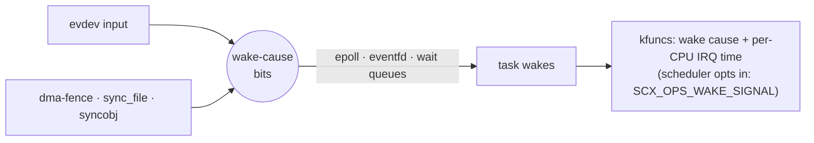

# sched_ext kernel patches — CachyOS 7.2.9

> Newer kernel: [CachyOS 7.2.10](../cachyos-7.2.10/).

Four kernel changes that make sched_ext schedulers cheaper to run or better informed, plus an
identity patch that tags the build `-exp`. Written for
[scx_cake](https://github.com/sched-ext/scx/tree/main/scheds/rust/scx_cake), but nothing is
specific to it: any sched_ext scheduler can use the new kfuncs and flags. All patches are
included here, split by feature; no private repository is needed.

**Legend** · 🟢 measured · 🔵 daily use · 🟡 boots · ⚪ applies / compiles · ⚠️ known issue

| # | Patch | In short | Status | Series |
|---|---|---|---|---|
| 1 | [bpf-native-scalar-bitops](0001-bpf-native-scalar-bitops.patch) | bit-counting as one CPU instruction | 🟢 microbenchmarks · 🔵 · game benefit unproven | ✅ default |
| 2 | [sched-ext-dsq-direct-index](0002-sched-ext-dsq-direct-index.patch) | dispatch queue by array index, not hash | 🔵 · speedup **not shown** | ✅ default |
| 3 | [sched-wake-signals](0003-sched-wake-signals.patch) | tell the scheduler a wake came from input or a GPU fence | ⚠️ warning fix not yet booted · no effect on KWin + NVIDIA | opt-in `series.wake-signals` |
| 4 | [sched-ext-lean-idle-claim](0004-sched-ext-lean-idle-claim.patch) | cheaper idle-CPU claim | 🟢 `lazy`: KovaaK's avg FPS +1.4 %, 1 % low +7.5 % | not in a series (apply by hand) |
| 5 | [identify-experimental-build](0005-identify-experimental-build.patch) | `uname -r` ends in `-exp` | ⚪ | ✅ both series |


The patches stack: each assumes the ones before it.

| Consumer | Patches |
|---|---|
| any sched_ext scheduler | 2 (kernel side only) |
| scx_cake `scx_cake-nightly` + [identity patch](../../../scheduler/scx-cake/fe07698/) | 1, 3, 4 (`--lean-idle`, default `lazy`) · each detected at start, stock fallback when absent |

---

## 🧩 Compatibility

| | Works with | Notes |
|---|---|---|
| Kernel | CachyOS tags `cachyos-7.2.9-1`, `cachyos-7.2.9-2` ([CachyOS/linux](https://github.com/CachyOS/linux)) | `base.json` pins `-1`; all touched files match `-2` · hashes checked, no fuzzy matching · kernel.org 7.2.9 untested · **7.3 needs a port** |
| CPU | any x86-64 (others untested) | patch 1's one-instruction path needs TZCNT, POPCNT, LZCNT (Haswell / Piledriver+), else ordinary calls · patch 4 needs ≤ 64 CPUs and the global idle mask, else its flags are ignored |
| Config | `BPF`, `BPF_SYSCALL`, `BPF_JIT`, `DEBUG_INFO_BTF`, `SCHED_CLASS_EXT` | patch 3's IRQ time also needs `IRQ_TIME_ACCOUNTING` · CachyOS default config has all |
| Flag bits | patches 3, 4 add experimental `SCX_OPS` bits 9, 10, 11 | may collide with future upstream flags · resolve names via the running kernel's BTF, never hard-code |

---

## ⚠️ Known issues

> [!WARNING]
> **Patch 3 logged one kernel warning per boot** — fixed in patch 3 since 2026-10-12, fix not
> yet booted. Builds from an older patch 3 still warn. **Do not use `panic_on_warn=1`** with patch 3.

```
WARNING: kernel/sched/core.c:7620 at default_wake_function+0x1a/0x30
 pollwake <- __wake_up_locked_key_flags <- eventfd_signal_mask_flags
 <- syncobj_eventfd_entry_fence_func <- dma_fence_signal
```

| | |
|---|---|
| Cause | wake-cause bits (`WF_SCX_INPUT` 0x100, `WF_SCX_FENCE` 0x200) ride the normal wake flags; stock `default_wake_function()` warns on anything but `WF_SYNC` / `WF_CURRENT_CPU` · the first `poll()` waiter on a GPU fence trips it, even with no scheduler opted in |
| Effect | one `dmesg` warning, kernel tainted `W`, wakeups still work · with `panic_on_warn=1`: panic at boot |
| Fix | `default_wake_function()` now also allows `WF_SCX_SIGNAL_MASK` |

---

## 🔧 Apply

Clean public source from [CachyOS/linux](https://github.com/CachyOS/linux):

| Tag | Commit |
|---|---|
| `cachyos-7.2.9-1` | `65a94cb5c1587a19242fe5a219f03343671f372e` |
| `cachyos-7.2.9-2` | `09bc889a111715e4509b3819b628c9b9d9d09a0b` |

Use your distribution's matching config and packaging. From this collection's root:

```bash
# default: patches 1–2 + 5
scripts/apply.sh kernel/sched-ext/cachyos-7.2.9 /path/to/linux-7.2.9 --check
scripts/apply.sh kernel/sched-ext/cachyos-7.2.9 /path/to/linux-7.2.9

# wake-signal research build (fresh source; read Known issues; no panic_on_warn=1)
scripts/apply.sh kernel/sched-ext/cachyos-7.2.9 /path/to/linux-7.2.9 --series series.wake-signals --check
scripts/apply.sh kernel/sched-ext/cachyos-7.2.9 /path/to/linux-7.2.9 --series series.wake-signals
```

The helper checks pinned hashes and preflights copies of touched files in `/tmp` (removed on
exit); it does not build or install a kernel.

<details>
<summary><b>CachyOS Kernel Manager</b> (takes one patch file)</summary>

```bash
cd kernel/sched-ext/cachyos-7.2.9
while IFS= read -r p; do
    case "$p" in ''|\#*) continue ;; esac
    cat -- "$p"
done < series > /tmp/sched-ext-cachyos-7.2.9.patch
```

Remove the temporary combined patch after importing it.
</details>

**After boot** ✅ `uname -r` ends in `-exp` · ✅ own package name, stock kernel kept in the boot
menu · ✅ build the [scx_cake nightly + identity patch](../../../scheduler/scx-cake/fe07698/) for native bitops,
lean idle or wake signals · see [TESTING.md](../../../TESTING.md).

---

## 1️⃣ Native scalar bit operations

| | |
|---|---|
| **Changes** | kfuncs `bpf_ctz64`, `bpf_popcnt64`, `bpf_clz64`, `bpf_mulhi64` · x86-64 JIT inlines counts as one `TZCNT` / `POPCNT` / `LZCNT` (when supported); mulhi = `MUL` + 2 moves · verifier learns results are 0–64 · one-argument calls marked fastcall · BPF selftest included |
| **Why** | schedulers scan bitmasks (idle CPUs, queues); BPF has no bit-count instruction, so the compiler emits a dozen-plus · scx_cake does this on every wakeup and every task start |
| **Expected** | 🟢 microbenchmarks: `ops.running` −2.31 ns, `select_cpu` −4.11 / −0.2 ns · fastcall and 0–64 bounds ➖ no effect · CLZ, MULHI unused by scx_cake now · 🎮 KovaaK's (2 rounds): no frame difference |
| **Test** | scx_cake picks native automatically; `--portable-bitops` forces the old path on the same boot |

## 2️⃣ Direct DSQ index

| | |
|---|---|
| **Changes** | a 2048-entry array per scheduler (16 KiB): DSQ IDs < 2048 found by one indexed read · larger IDs keep the hash, with a cheaper typed compare (backport, upstream from 7.4; adapted from [Usama Arif's patch](https://lore.kernel.org/all/20260921171928.1639407-1-usama.arif@linux.dev/)) · the direct index and its lifecycle are the local experiment |
| **Why** | every queue op hashes and compares a usually small ID · all scx_cake IDs are < 2048 |
| **Expected** | a few ns per queue op · **not shown**: VM passed, timing inconclusive, no hardware comparison yet |
| **Test** | two boots, one with `sched_ext.dsq_direct=0` · `cat /sys/kernel/sched_ext/root/dsq_direct_entries` while a scheduler runs: 2048 = on, 0 = off |

## 3️⃣ Wake signals



| | |
|---|---|
| **Changes** | records whether a wake came from input or a GPU fence, carried through epoll, eventfd and wait queues · two kfuncs read the cause and each CPU's recent IRQ time · causes recorded only for an opted-in scheduler, but the bits travel the wake paths on every boot |
| **Why** | a wake from a mouse move or finished frame is urgent; a timer wake usually is not → send urgent wakes straight to a free CPU, avoid IRQ-busy CPUs |
| **Expected** | KWin + NVIDIA: **0 of 8.4M wakes tagged** in 90 s (input via KWin's Wayland socket, NVIDIA's own waits) → no benefit there · AMD / Intel on Mesa: open question |
| **Test** | `scx_cake --kernel-signals observe --signal-report report.csv` counts without changing placement · a report with tagged wakes > 0 (AMD / Intel) is the most useful result now |

## 4️⃣ Lean idle claim

| Part | Change |
|---|---|
| K1 | claim with one atomic op on one word, before the scheduler lookup and CPU checks |
| K2 | idle and SMT masks in one 128-byte block (they sat 32 cache lines apart) |
| K3 `SCX_OPS_LEAN_IDLE_LAZY_SMT` | skip the SMT-mask write on a successful claim; the claimed CPU clears it when it goes busy |
| K4 | read before every write, so correct bits are not rewritten |

Opt-in (`SCX_OPS_LEAN_IDLE`), ≤ 64 CPUs.

| | |
|---|---|
| **Why** | claiming an idle CPU is ~60 % of scx_cake's `select_cpu`; two far-apart masks dirty two shared lines per claim |
| **Measured** | 🟢 KovaaK's menu, quiet, `lazy` vs `off`: avg FPS **+1.4 %**, p99 **−5.1 %**, 1 % low **+7.5 %** (16/16 pairs) · 16 CPU hogs: 0.1 % low +6.6 %, worst frame −16 %, nothing worse · `on` ≈ `off` |
| **Why lazy** | K1/K2 cut `select_cpu` 82 → 68 ns; K3 keeps a just-claimed core "whole idle" until it runs, so ~6 points more wakes return to their cache-warm CPU · both halves are needed |
| **Test** | apply by hand after 1–3 in a disposable tree · scx_cake nightly: `--lean-idle off` / `on` / `lazy` on one boot (`lazy` is its default) · the bundled companion cannot do this |

## 5️⃣ Experimental build identity

| | |
|---|---|
| **Changes** | adds `localversion.30-exp` (`-exp`), appended after the PKGBUILD's `localversion.10-pkgrel` / `.20-pkgname` → `7.2.9-1-cachyos-exp` |
| **Why** | tell patched from stock at a glance: `uname -r`, module tree, every bug report |
| **Expected** | no code change · release string and `/usr/lib/modules` dir end in `-exp` · a KWin build from this collection gates on it: `./install.sh --kernel <release>` |
| **Test** | `uname -r` after boot |

---

## 📋 Tested on

Newest first · tester results get a row too.

| Date | Kernel | Patches | How far | Machine | Result |
|---|---|---|---|---|---|
| 2026-10-12 | `7.2.9-2-cachyos-custom` | 1–4 | 🟢 patch 1, game | 9800X3D, RTX 4090, KWin | KovaaK's, native vs `--portable-bitops`, 6×20 s runs in both slot orders + one loaded: no frame difference (round 1 favoured portable's tails; round 2 did not replicate, loaded pooled 17–21/36 pairs) · callback cost equal (±1–2 ns); JIT inlines |
| 2026-10-12 | `7.2.9-2-cachyos-custom` | 1–4 | 🟢 patch 4, loaded | 9800X3D, RTX 4090, KWin | 16 nice-10 hogs (98 % busy), `lazy` vs `off`: p99.9 −2.4 %, 0.1 % low +6.6 %, worst frame −16 %, nothing worse · scx_cake defaults to `lazy` |
| 2026-10-12 | `7.2.9-2-cachyos-custom` | 1–4 | 🟢 patch 4 | 9800X3D, RTX 4090, KWin | KovaaK's 12×30 s ABBA: `lazy` vs `off` avg FPS +1.4 %, p99 −5.1 %, 1 % low +7.5 % (16/16) · `on` ≈ `off` · one scene, quiet host |
| 2026-10-12 | CachyOS 7.2.9-1 source | 1–5 | ⚪ applies | — | patch 3 with the `default_wake_function()` fix; `series.wake-signals` and 1–4 stacked apply with no fuzz · fix not compiled or booted |
| 2026-10-11 → | `7.2.9-2-cachyos-custom` | 1–4 (3 unfixed) | 🟡 boots | 9800X3D, RTX 4090 | `SCX_OPS_LEAN_IDLE` in BTF · patch 3 warning still logged |
| 2026-10-09 | CachyOS 7.2.9-1 source | 1–3, 5 | ⚪ applies | — | both series, no fuzz · `7.2.9-1-cachyos-exp` |
| 2026-10-07 | CachyOS 7.3-rc6 (`cachyos-7.3-rc6-1`) | 1–4 | ⚪ applies | — | 1, 2, 3 fail; 4 with offsets → port needed |
| 2026-10-07 | CachyOS 7.2.9-2 source | 1–4 | ⚪ applies | — | no fuzz; touched files identical to 7.2.9-1 |
| 2026-10-07 | mainline `2709dd5ae32f` (7.2.0) | 1–4 | ⚪ applies | — | 1, 3 fail; 2, 4 with offsets |
| 2026-10-05 | CachyOS 7.2.9-1 source | 1–4 | ⚪ compiles | — | no fuzz; touched files compile (clang 23.1.1, `LLVM=1`, ThinLTO); not linked or booted |
| 2026-10-04 → | `7.2.9-1-cachyos-custom` | 1–3 | 🔵 daily use | 9800X3D, RTX 4090 (NVIDIA 615.71.09) | works with scx_cake · one patch-3 warning per boot |
| 2026-10-02 | CachyOS 7.2.8-1, QEMU | 1–3 | 🟡 boots (VM) | QEMU, no KVM | scx_cake native + portable; 20,844 bitops checks; 393,216 DSQ create/destroy; 20-case wake-signal contract · 2 debug-kernel failures also happen without the patches |
| 2026-09-30, 10-01 | `7.2.8-1-cachyos-custom` | early 1 | 🟡 boots | 9800X3D | JIT emits TZCNT/POPCNT; scx_cake runs |

The 7.2.9 daily-use kernel was built from the 7.2.8 version of patches 1–3 (applied with
offsets); the code equals patches 1–3 here.
